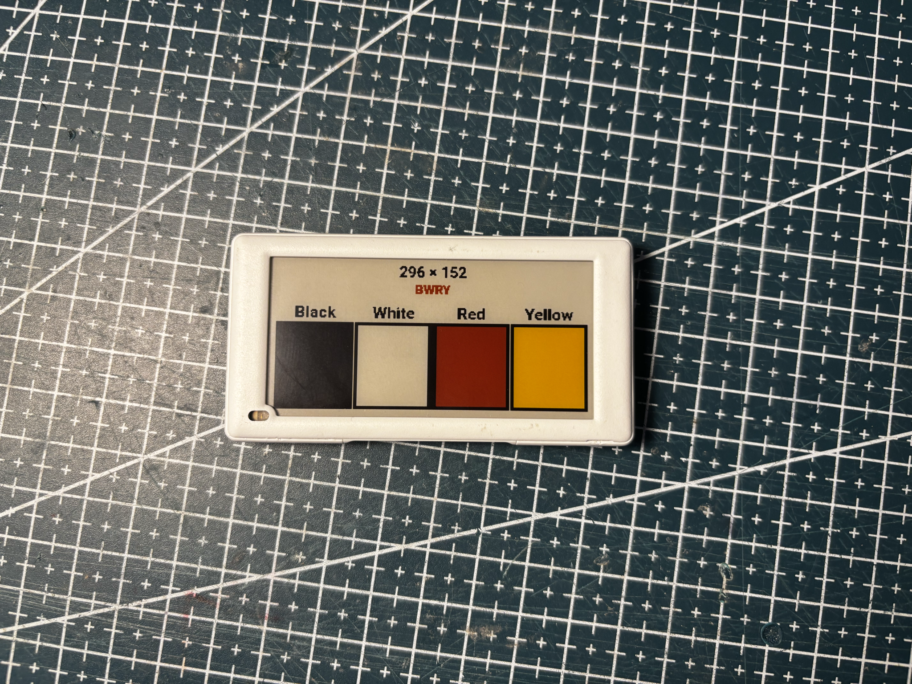
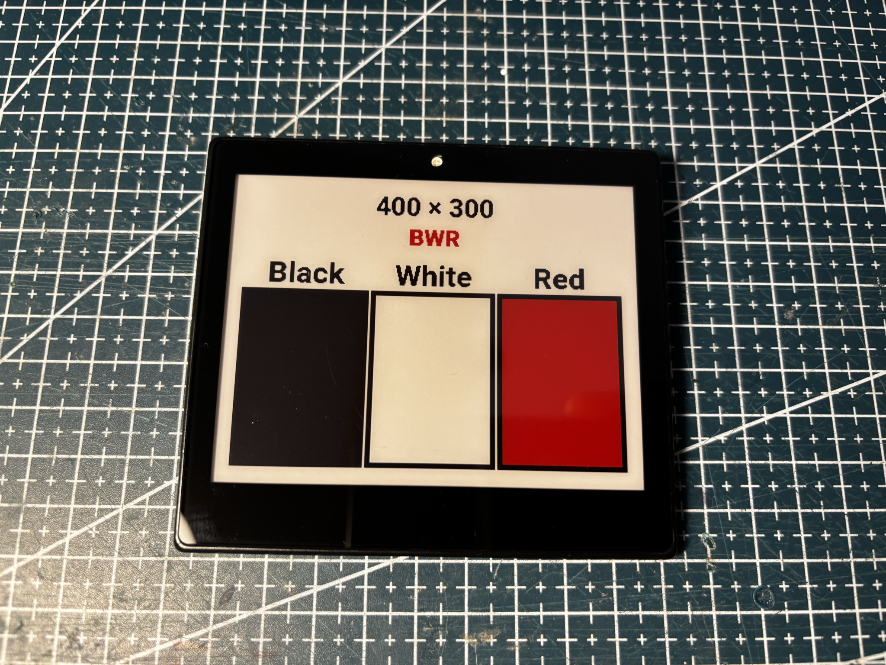
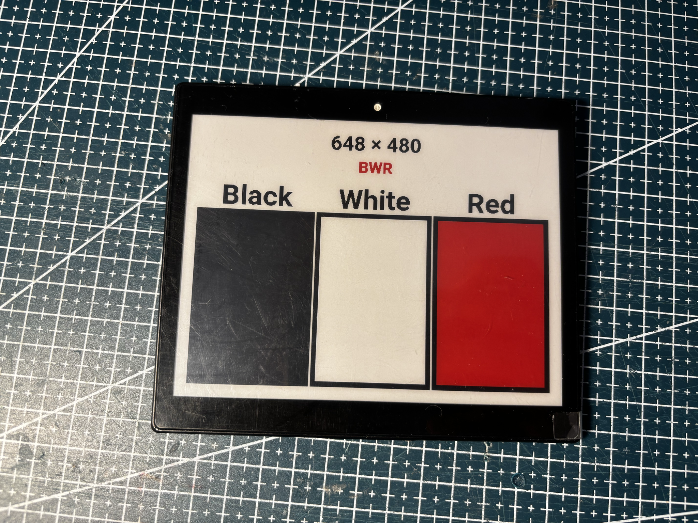
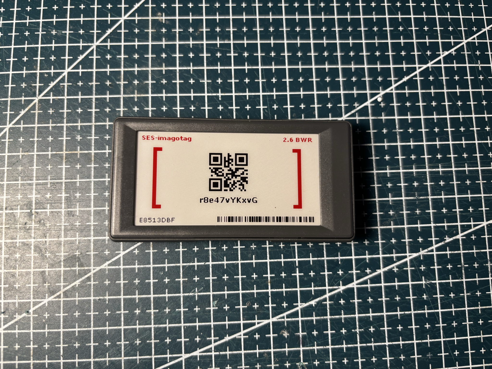
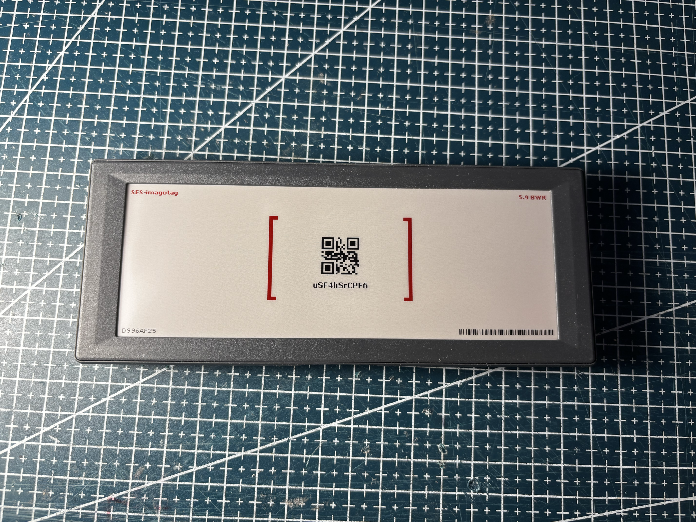
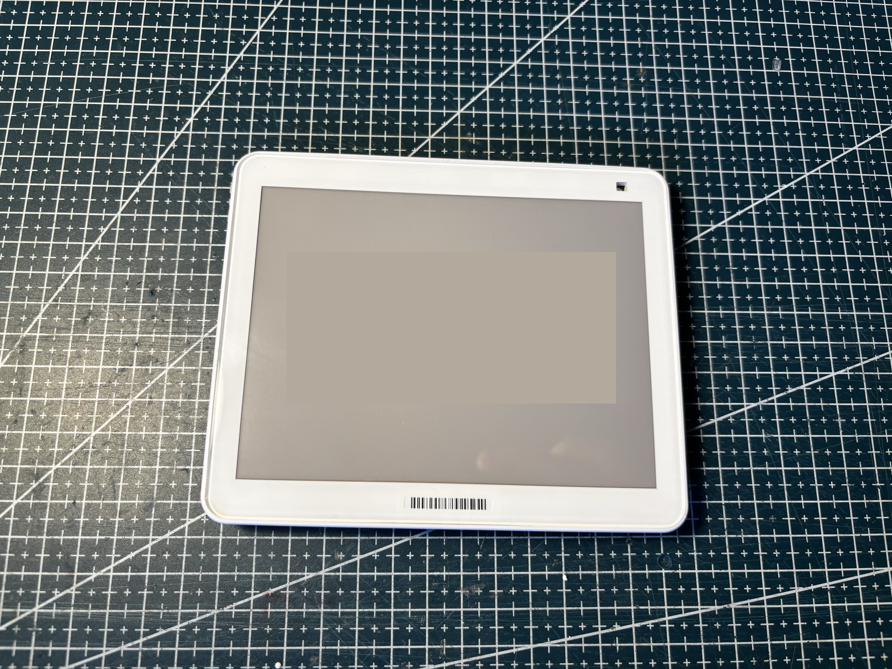
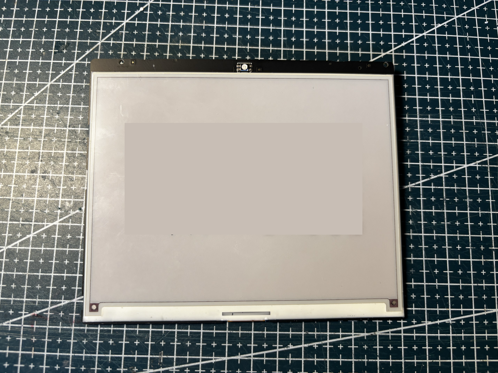

# My e-paper wiki

A collection of retail tags and e-paper displays I've come across.

|                                                                                     |                                                                                               |                                                                                            |
| ----------------------------------------------------------------------------------- | --------------------------------------------------------------------------------------------- | ------------------------------------------------------------------------------------------ |
|  |  |         |
|  |    |  |

I am not affiliated with any brand/project listed below. I am not an expert, this is a shared notebook so others can reuse the **display** if they buy similar tags.

I've tried to reference everything I had in my archives, but coverage is imperfect: some photos may be blurry or missing, and some revisions, colorways, or extra details may not be listed yet. If you need a clearer shot, a missing variant, or complementary info added, please open an issue or PR, I'm happy to fill the gaps.

**Out of scope:** I will not discuss, review, or accept PRs or issues about vendor stock firmware, proprietary RF stacks, locked-down boards, or pairing tags with a vendor’s proprietary cloud. I will reject PRs and questions that aim to modify, bypass, or reuse official patented or proprietary retail infrastructure.

---

## Repository layout

```
the-epaper-wiki/
├── readme.md          ← you are here
├── tags/              ← one folder per retail tag
│   └── {brand}/
│       └── {TAG-ID}/
│           ├── README.md
│           ├── pictures/    ← all tag photos (housing, PCB, battery, …)
│           ├── doc/         ← markings transcribed from labels
│           ├── code/        ← example panel.ino when a driver is known
│           └── subs/        ← other housing colors / revisions (working on it)
└── screens/           ← one folder per panel
    └── {size}/
        └── {palette}/
            └── {panel-id}/
                ├── README.md
                ├── pictures/    ← panel shots copied from source tags
                ├── code/        ← copy of example sketch when available
                ├── doc/
                └── subs/
```

**Tags** describe the product you hold in your hand (housing, batteries, radio board, debug pads). **Screens** describe the removable panel: flex part number, resolution, controller IC, GxEPD2 class, etc...

---

## Brands documented

|                                                                                                                 | Brand                                    | Index                                                                    |
| --------------------------------------------------------------------------------------------------------------- | ---------------------------------------- | ------------------------------------------------------------------------ |
|                             | Solum (Newton)                           | [tags/solum/README.md](tags/solum/README.md)                             |
|                       | Hanshow (Nebular, Stellar, Polaris)      | [tags/hanshow/README.md](tags/hanshow/README.md)                         |
|  | SES-imagotag / Vusion (Pervasive panels) | [tags/vusion-ses_imagotag/README.md](tags/vusion-ses_imagotag/README.md) |
|                          | All panels (by size)                     | [screens/README.md](screens/README.md)                                   |

Panel size folders use a three-digit code (e.g. `280` ≈ 2.8", `583` ≈ 5.83", `581` ≈ 5.81"). Palette codes are `BWR`, `BWRY`, etc.

---

## Contributing

Contributions are welcome: new tag folders following the same layout, extra photos, corrected markings, confirmed GxEPD2 classes, or third-party **open-source** firmware compatibility notes. Open a PR or issue with photos and probe notes when possible or simply ask if something from your unit is not documented yet.

By contributing, you agree that your original code is under the MIT License and your original text and photographs are under CC BY 4.0, and you confirm that you have the right to submit the material. If a file comes from another project, keep that project's license and say so in the pull request. See [NOTICE.md](NOTICE.md).

---

## License

Original work in this repository is dual-licensed. See [LICENSE](LICENSE) and [NOTICE.md](NOTICE.md).

| Material                          | License                                                   |
| --------------------------------- | --------------------------------------------------------- |
| Original code (`.ino` sketches)   | [MIT](https://spdx.org/licenses/MIT.html)                 |
| Original text and photographs     | [CC BY 4.0](https://creativecommons.org/licenses/by/4.0/) |
| Files copied from another project | That project's license                                    |

A file with its own license notice stays under that notice. MIT and CC BY 4.0 do not relicense it. Trademarks of the manufacturers named in these pages are not licensed.
