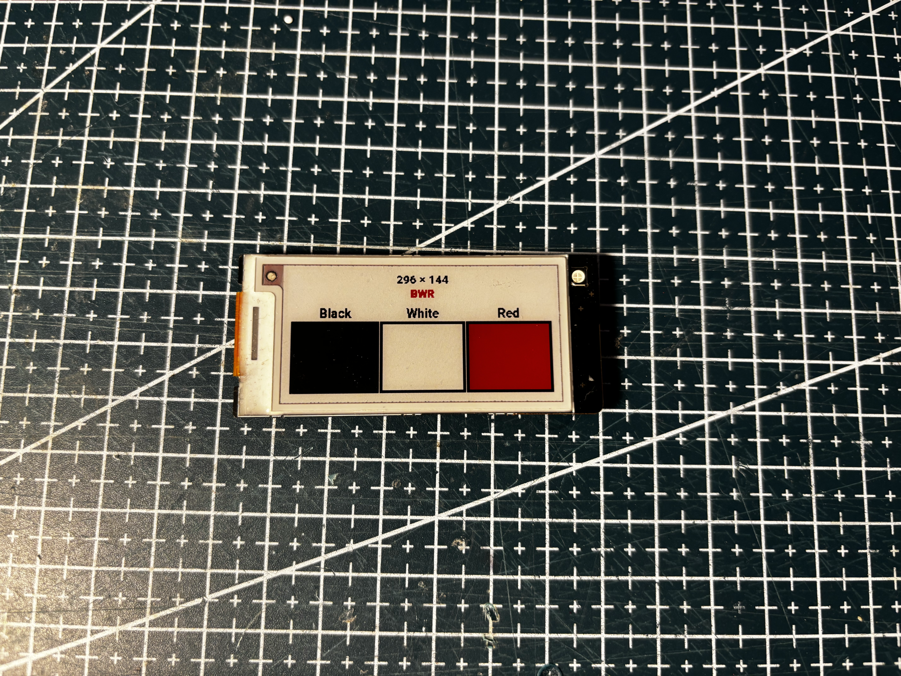

# HINK-E0213A265

Three-color **2.13"** class panel (BWR). Flex **HINK-E0213A265-FPC-A0**.

## Notes

|               |                                  |
| ------------- | -------------------------------- |
| Flex          | HINK-E0213A265-FPC-A0, XYTD 2235 |
| Panel sticker | HE213AG587 / 29T00BP189          |
| Driver        | none                             |

## Code

TBD when a GxEPD2 probe is confirmed.

## Extracted from retail tags

| Tag | Panel source |
| --- | --- |
|  | [HS-213-NEBULAR-BWR](../../../../tags/hanshow/HS-213-NEBULAR-BWR/README.md) |

## Panel photos

