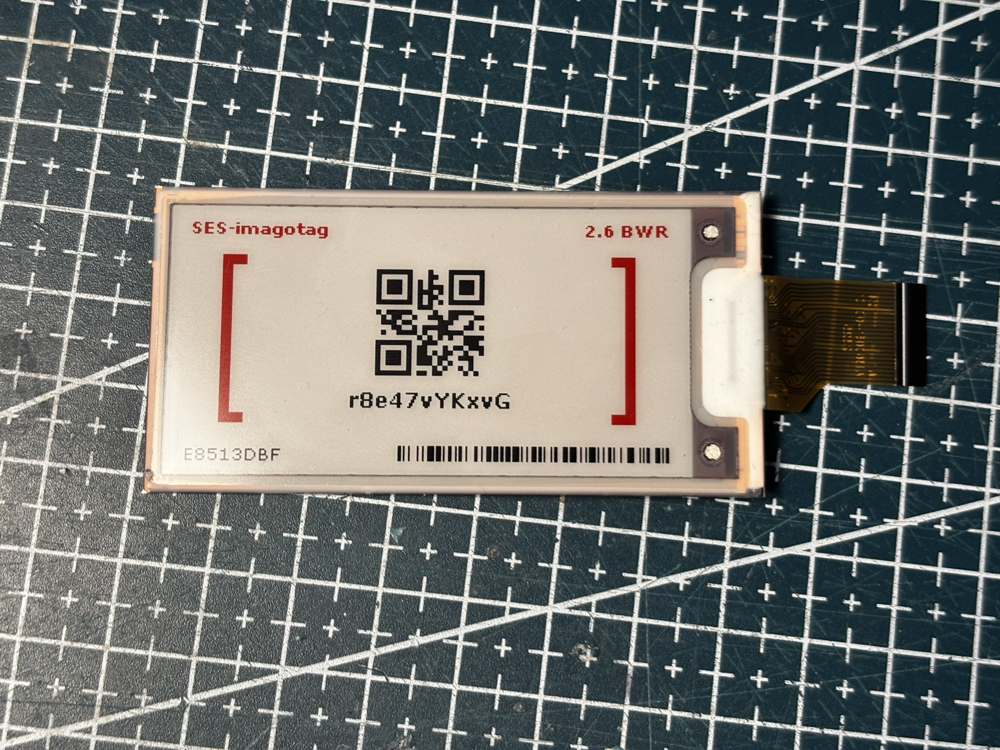
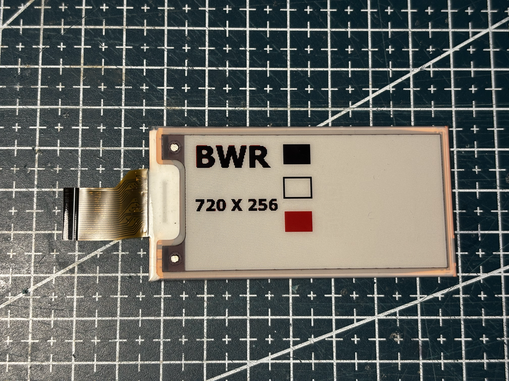

# SE2266JS0C5

Pervasive **2.66"** panel, **296×152** BWR (native 152×296, rotation 3).

## Notes

|                 |                                     |
| --------------- | ----------------------------------- |
| Sticker         | SE2266JS0C5 / SPP1ZV1 / 24116-00626 |
| Controller      | iTC SmallCJ                         |
| GxEPD2          | `GxEPD2_266c_SE2266JS0C5`           |
| Full refresh    | about 20 s                          |

## Code

Pervasive vendor GxEPD2 fork required.

## Extracted from retail tags

| Tag | Panel source |
| --- | --- |
|  | [VU-2.6-GU110-BWR](../../../../tags/vusion-ses_imagotag/VU-2.6-GU110-BWR/README.md) |

Example sketch: [panel.ino](../../../../tags/vusion-ses_imagotag/VU-2.6-GU110-BWR/code/panel.ino).

## References from photos

| Photo                                                                                | Extracted references                                                                                                                                         |
| ------------------------------------------------------------------------------------ | ------------------------------------------------------------------------------------------------------------------------------------------------------------ |
|  | `24116-00626` (Panel module / glass ID); `B00D78211J` (Panel module / glass ID); `SE2266JS0C5` (Flex / FPC part number); `SPP1ZV1` (Panel module / glass ID) |

## Panel photos

## Acknowledgements

This panel runs with the driver classes from [shanislav/GxEPD2_PervasiveDisplays](https://github.com/shanislav/GxEPD2_PervasiveDisplays). Thanks to [shanislav](https://github.com/shanislav) for the driver classes, I lost a lot of time trying to get this panel working before finding this repository.
