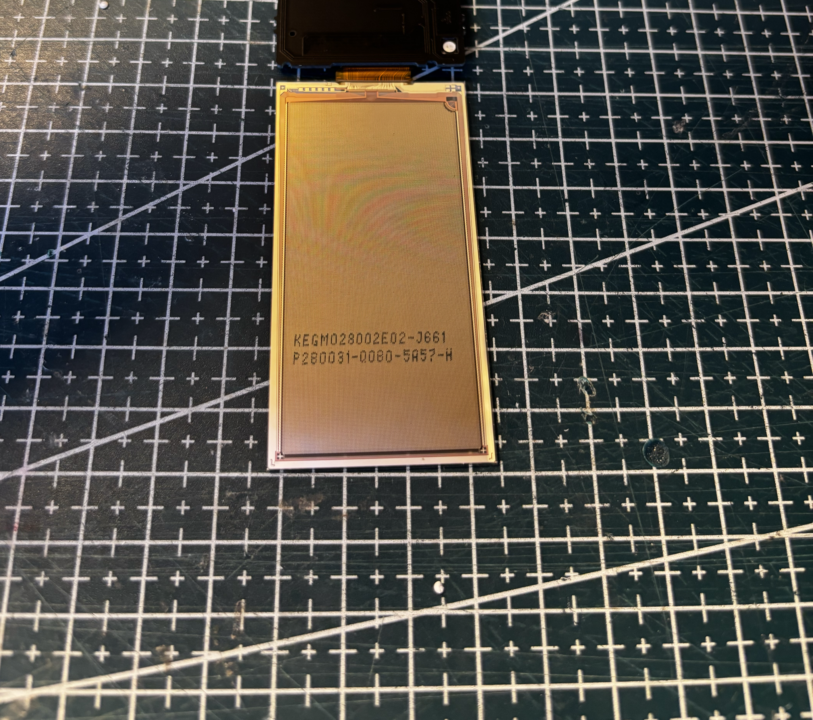
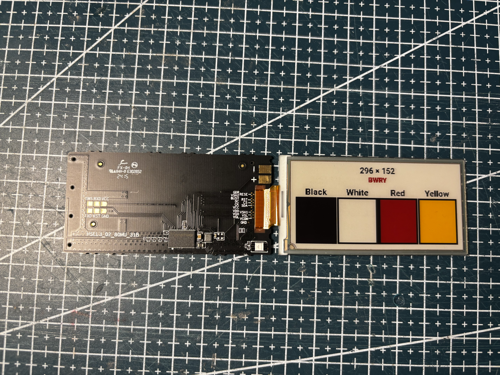

# KEGM028002E02-J661

Four-color **2.8"** class panel from Hanshow Polaris Pro-280Q-N.

## Notes

| | |
| --- | --- |
| Marks | KEGM028002E02-J661, P280031-0080-5A57-H |
| Colors | BWRY |
| Driver | not validated yet |

## Code

TBD.

## Extracted from retail tags

| Tag | Panel source |
| --- | --- |
|  | [HS-290-POLARIS-PRO-BWRY](../../../../tags/hanshow/HS-290-POLARIS-PRO-BWRY/README.md) |

<!-- photo-refs:start -->

## References from photos

| Photo | Extracted references |
| --- | --- |
|  | `KEGM028002E02-J661` (Panel module / glass ID); `P280031-Q080-5A57-H` (Panel module / glass ID) |

<!-- photo-refs:end -->

## Panel photos

