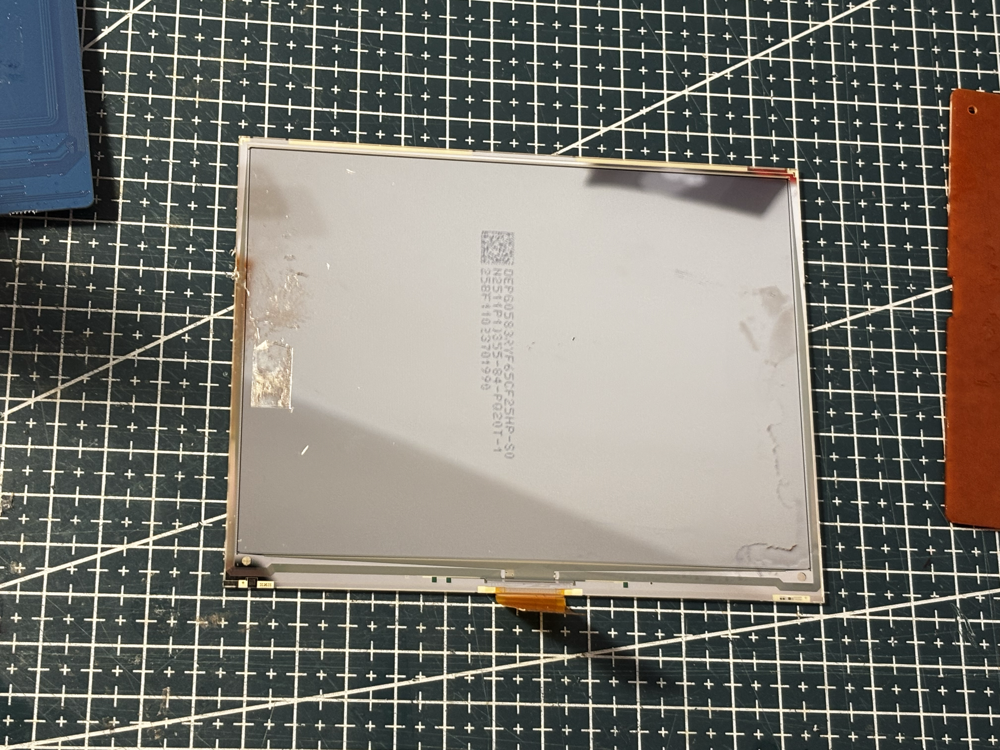
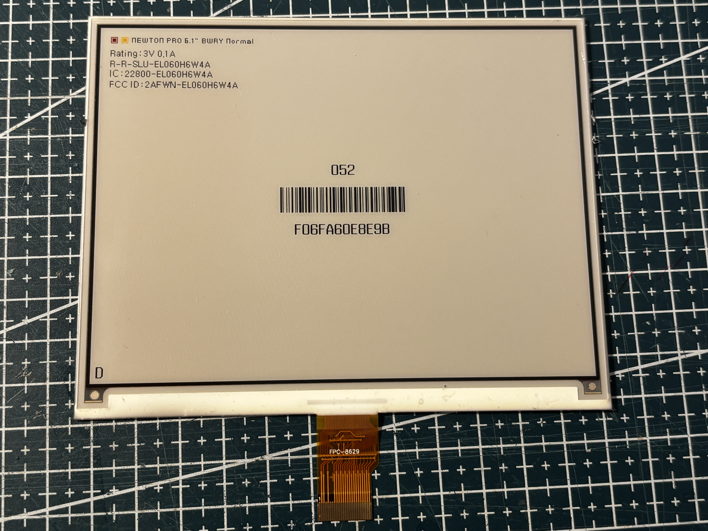

# References — FPC-8629

## References from photos

| Photo | Extracted references |
| --- | --- |
|  | `25BF11023701990` (Barcode / serial / MAC); `DEP605832YF65CF25HP-S0` (Panel module / glass ID); `N2511P1J355-84-P020T-1` (Panel module / glass ID) |
|  | `FCC ID: 24FWN-EL060H6W4A` (FCC / IC / CE / UKCA text); `IC: 22800-EL060H6W4A` (FCC / IC / CE / UKCA text); `NEWTON PRO 6.1" BWRY Normal` (ESL tag model / SKU); `R-R-SLU-EL060H6W4A`; `Rating: 3V 0.1A` |
