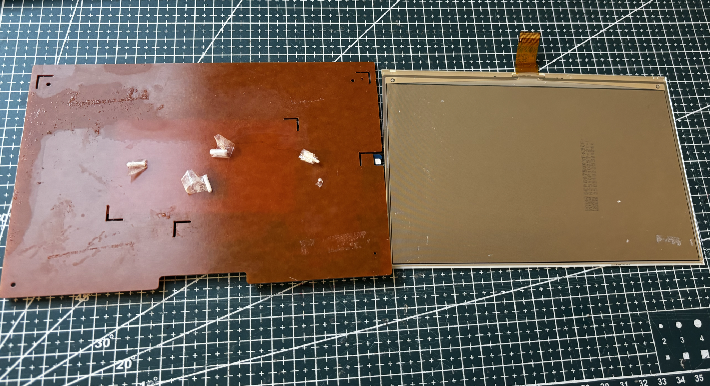

# FPC-7909

Four-color **7.5"** panel, 800×480. Flex **FPC-7909**.

## Notes

|              |                       |
| ------------ | --------------------- |
| Flex         | FPC-7909              |
| Resolution   | 800×480               |
| Controller   | JD79665AA             |
| BUSY         | idle HIGH, active LOW |
| Full refresh | about 23 s            |

## Code

`GxEPD2_750c_GDEM075F52`.

## Extracted from retail tags

| Tag                                                                                                          | Panel source                                                            |
| ------------------------------------------------------------------------------------------------------------ | ----------------------------------------------------------------------- |
|  | [SL-75-BK-750-BWRY](../../../../tags/solum/SL-75-BK-750-BWRY/README.md) |

Example sketch: [panel.ino](../../../../tags/solum/SL-75-BK-750-BWRY/code/panel.ino).

## Panel photos

