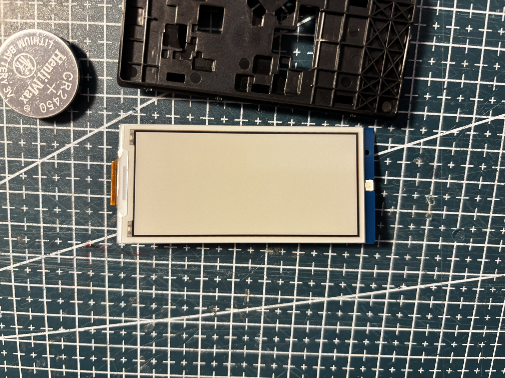
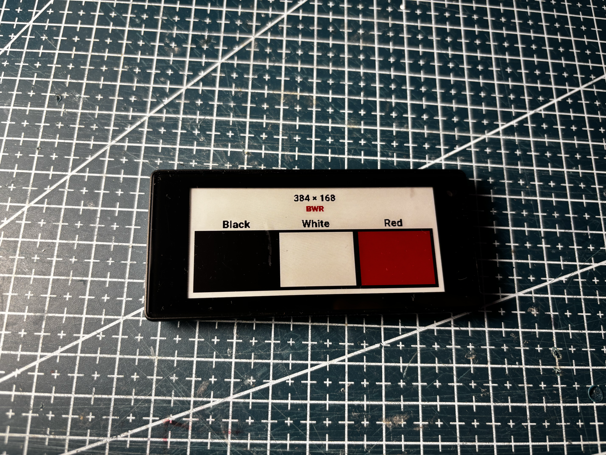
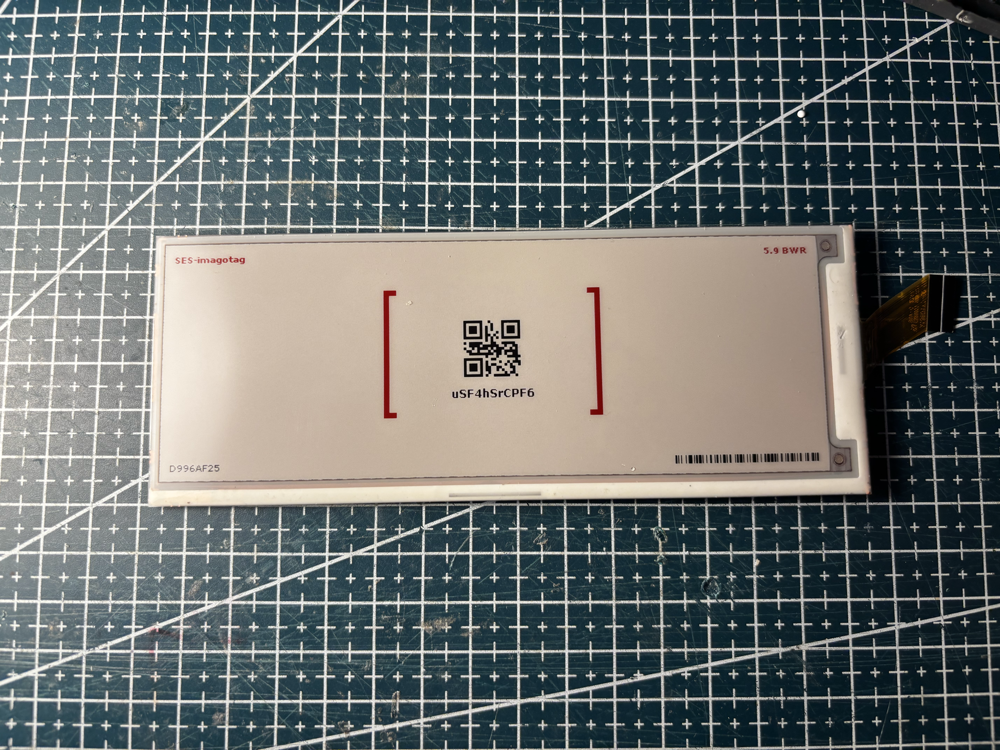

# Screens

`screens/{nominal_size}/{palette}/{panel-id}/`

- **nominal_size** — approximate diagonal in mm (213 ≈ 2.13", 583 ≈ 5.83", 610 ≈ 6.1", …)
- **palette** — `BWR`, `BWRY`, etc.
- **panel-id** — flex sticker or supplier part (HINK-…, FPC-…, SE…, …)

## Index (by size)

| Preview                                                                                                 | Size | Palette | Panel                                                       |
| ------------------------------------------------------------------------------------------------------- | ---- | ------- | ----------------------------------------------------------- |
|                 | 213  | BWR     | [HINK-E0213A265](213/BWR/HINK-E0213A265/README.md)          |
|                         | 266  | BWR     | [SE2266JS0C5](266/BWR/SE2266JS0C5/README.md)                |
|                  | 280  | BWRY    | [HINK-E0276A01](280/BWRY/HINK-E0276A01/README.md)           |
|                                | 290  | BWR     | [FPC5715](290/BWR/FPC5715/README.md)                        |
|  | 290  | BWRY    | [KEGM028002E02-J661](290/BWRY/KEGM028002E02-J661/README.md) |
| {TODO : rajouter image hanshow 420}                                                                     | 420  | BWR     | [143302](420/BWR/143302/README.md)                          |
| {TODO : rajouter image hanshow 420}                                                                     | 420  | BWR     | [612326](420/BWR/612326/README.md)                          |
|                         | 581  | BWR     | [SE2581JS0G1](581/BWR/SE2581JS0G1/README.md)                |
|                  | 583  | BWR     | [HINK-E0583A01](583/BWR/HINK-E0583A01/README.md)            |
|                       | 610  | BWRY    | [FPC-8629](610/BWRY/FPC-8629/README.md)                     |
|                            | 750  | BWRY    | [FPC-7909](750/BWRY/FPC-7909/README.md)                     |

References extracted from the pictures; may contain minor misspellings due to volume and manual review.
