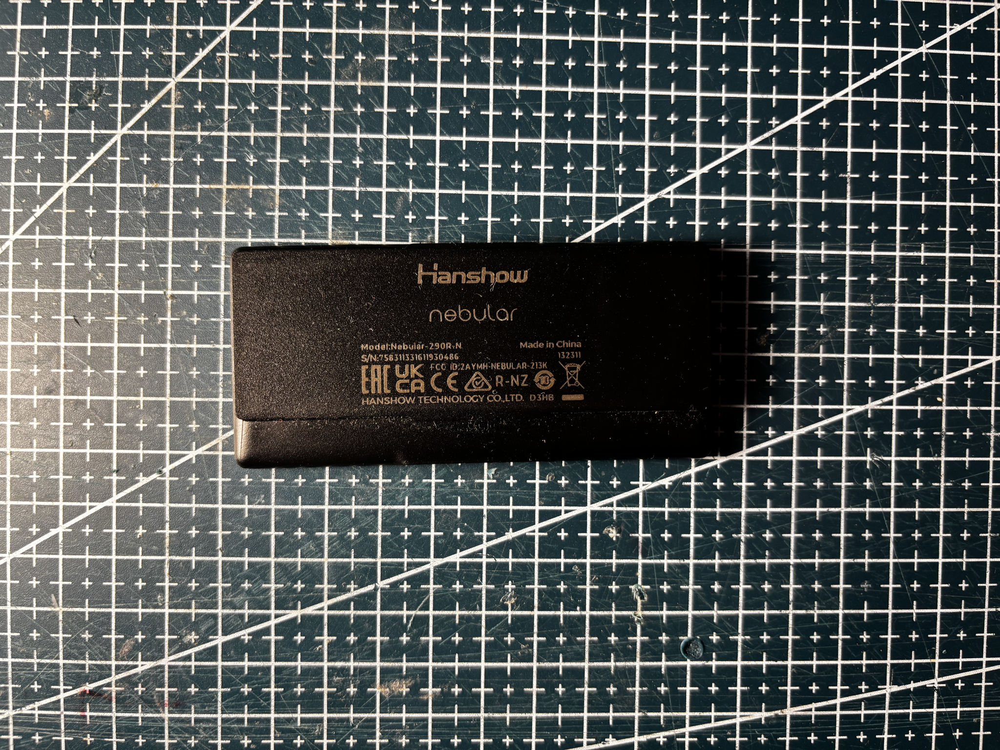

# References — HS-290-NEBULAR-BWR

## Markings

Rear label:

- Hanshow nebular
- Nebular-290R-N
- S/N 756311511611930486
- FCC ID 2AYHH-NEBULAR-213K
- Batch 132311
- CE, UKCA, EAC, R-NZ, WEEE

## References from photos

| Photo | Extracted references |
| --- | --- |
|  | `132311` (Date code / lot); `FCC ID: 2AYMM-NEBULAR-213K` (FCC / IC / CE / UKCA text); `Hanshow` (Brand or vendor name); `nebular` (Brand or vendor name); `Nebular-290R-N` (ESL tag model / SKU) |
|  | `384 x 168` (Other useful string); `BWR` (Other useful string) |
