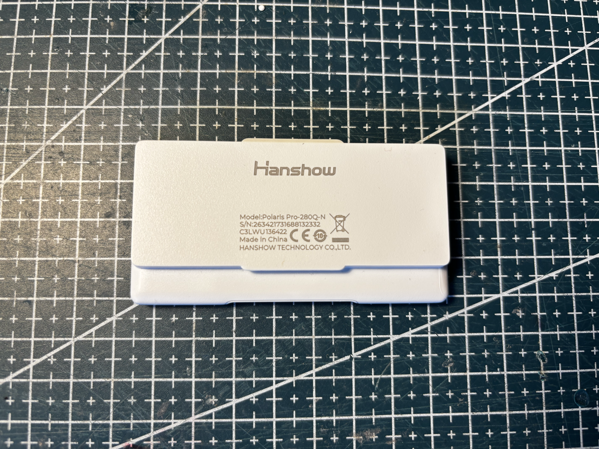
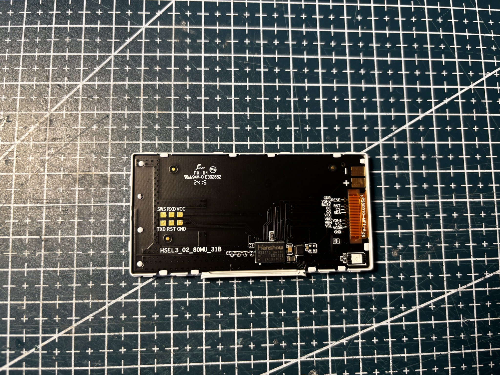
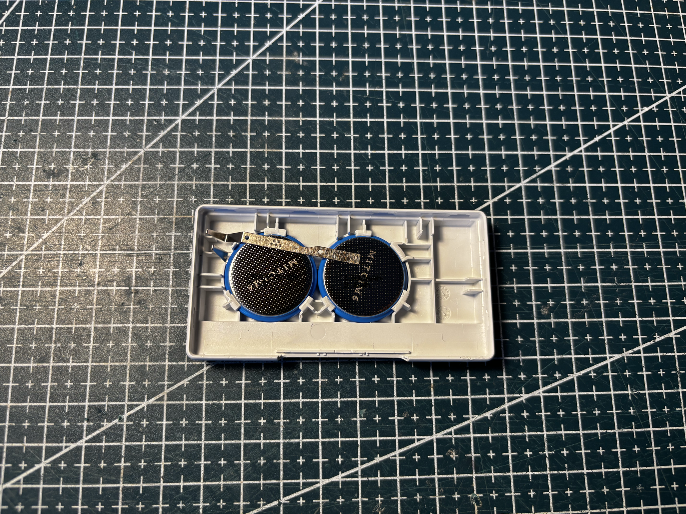
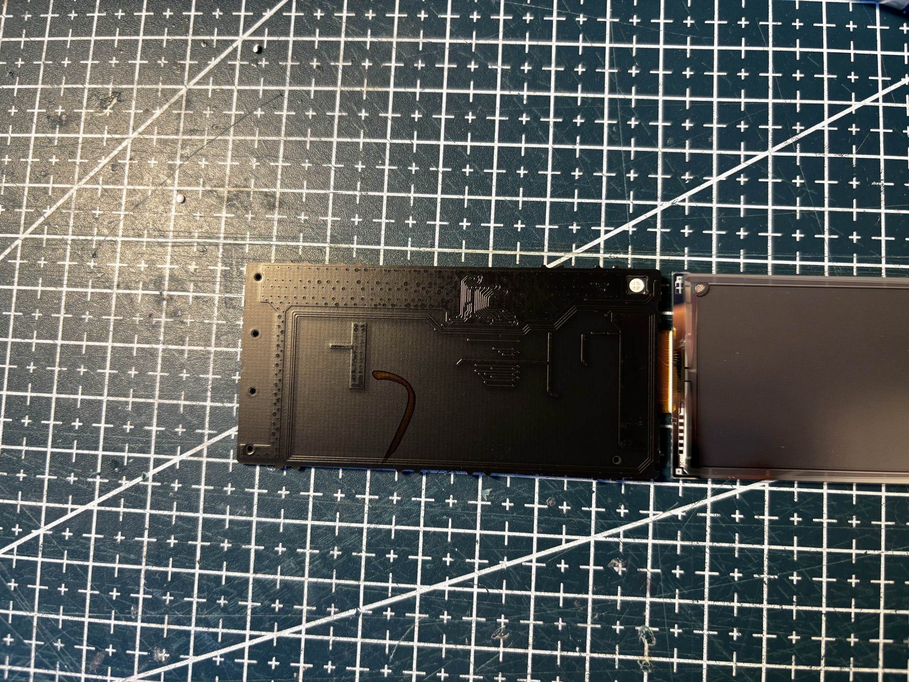

# HS-290-POLARIS-PRO-BWRY

Hanshow **Polaris Pro-280Q-N**, white housing. Four-color (BWRY) 2.8" class tag.

## Identity

|         |                                                                              |
| ------- | ---------------------------------------------------------------------------- |
| Brand   | Hanshow                                                                      |
| Name    | Polaris Pro                                                                  |
| Model   | Polaris Pro-280Q-N                                                           |
| Housing | white                                                                        |
| Panel   | [KEGM028002E02-J661](../../../screens/290/BWRY/KEGM028002E02-J661/README.md) |

Details in [doc/references.md](doc/references.md).

## Panel

Removed panel marked **KEGM028002E02-J661** / **P280031-0080-5A57-H**.

## References from photos

| Photo                                                                                                | Extracted references                                                                                                                                                                                                                                                                                                                                                       |
| ---------------------------------------------------------------------------------------------------- | -------------------------------------------------------------------------------------------------------------------------------------------------------------------------------------------------------------------------------------------------------------------------------------------------------------------------------------------------------------------------- |
|      | `136422` (Other useful string); `C3LWU` (Date code / lot); `Hanshow` (Brand or vendor name); `Polaris Pro-280Q-N` (ESL tag model / SKU)                                                                                                                                                                                                                                    |
|  | `241311019` (Panel controller IC); `2415` (Date code / lot); `94V-0` (PCB silkscreen / revision); `B4110` (Brand or vendor name); `E302852` (PCB silkscreen / revision); `ENT123` (Panel controller IC); `FX-D1` (PCB silkscreen / revision); `HS9118` (Panel controller IC); `HSEL3_02_80MU_31B` (PCB silkscreen / revision); `P280010-MF1-A 26` (Flex / FPC part number) |
|  | `2415` (Date code / lot); `94V-0` (PCB silkscreen / revision); `E362652` (PCB silkscreen / revision); `FX-D1` (PCB silkscreen / revision); `HSEL3_02_80MU_31B` (PCB silkscreen / revision)                                                                                                                                                                                 |
|  | `KEGM028002E02-J661` (Panel module / glass ID); `P280031-Q080-5A57-H` (Panel module / glass ID)                                                                                                                                                                                                                                                                            |

## Photos

### Front

### Back

### Battery

### PCB

### Pinout

### Screen

## Compatible third-party firmware

| Firmware                                                                              | Notes                                                   |
| ------------------------------------------------------------------------------------- | ------------------------------------------------------- |
| [OpenEPaperLink](https://github.com/OpenEPaperLink/OpenEPaperLink)                    | Open-source ESL access point and tag firmware ecosystem |
| [ATC BLE OEPL image upload](https://atc1441.github.io/ATC_BLE_OEPL_Image_Upload.html) | Flash OpenEPaperLink on supported Hanshow tags over BLE |

## Acknowledgements

Thanks to the [OpenEPaperLink](https://github.com/OpenEPaperLink/OpenEPaperLink) team, and to [atc1441](https://github.com/atc1441) for the Hanshow BLE path and the [ATC BLE OEPL image upload](https://atc1441.github.io/ATC_BLE_OEPL_Image_Upload.html) tool.
