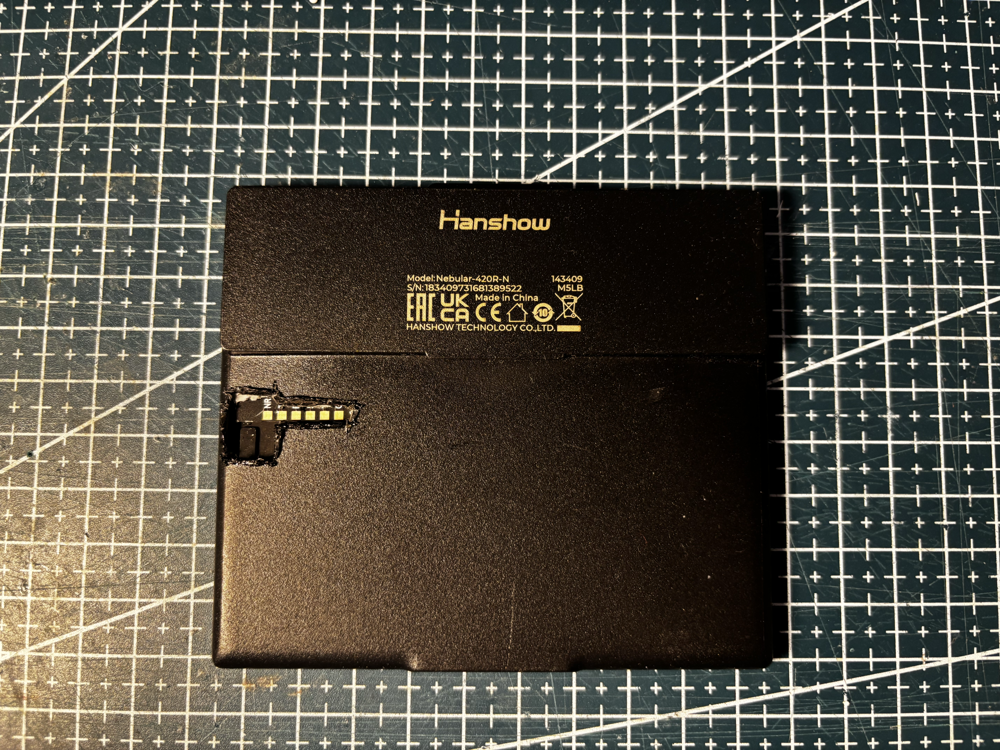
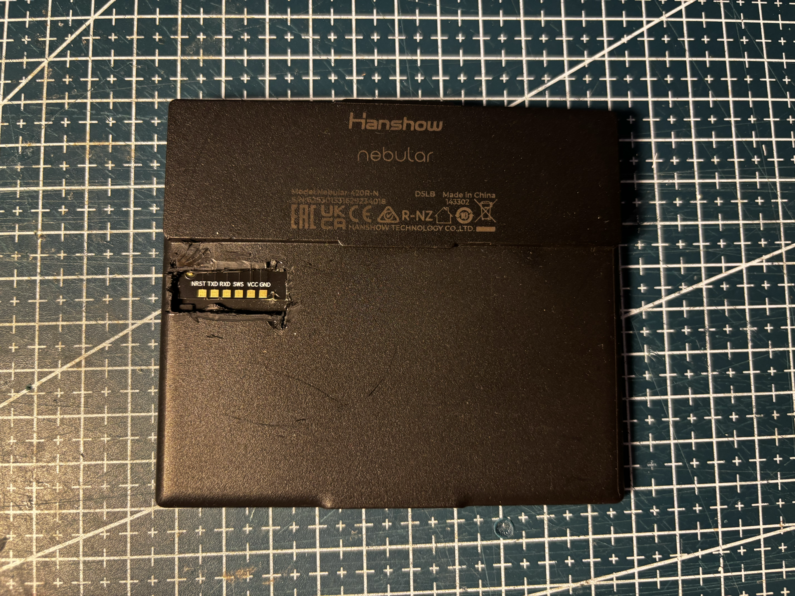
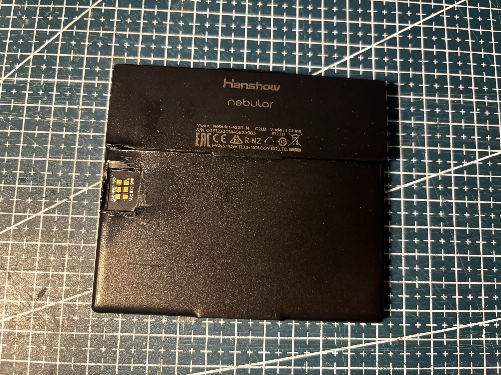
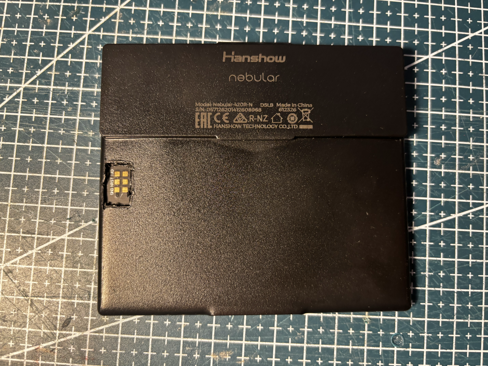
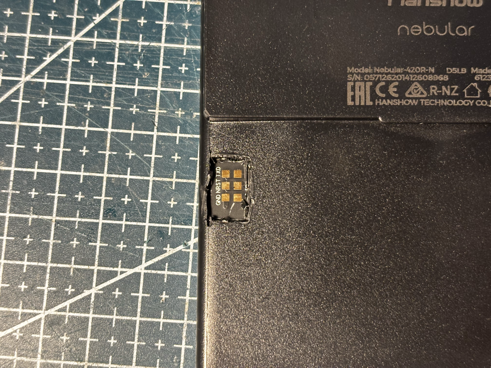

# HS-420-NEBULAR-BWR

Hanshow **Nebular-420R-N**, black housing.


## Identity

|         |                                                                   |
| ------- | ----------------------------------------------------------------- |
| Brand   | Hanshow                                                           |
| Name    | Nebular                                                           |
| Model   | Nebular-420R-N                                                    |
| Housing | black                                                             |
| Panel   | [143302](../../../screens/420/BWR/143302/README.md), BWR, 400×300 |

Details in [doc/references.md](doc/references.md).

## Board

Debug pads exposed on the back shell: **NRST**, **TXD**, **RXD**, **SWI**, **VCC**, **GND** (photo labels).

## Panel

Controller **UC8276**. Use `GxEPD2_420c_Z21`.

## Reuse

```cpp
#include <GxEPD2_3C.h>

GxEPD2_3C<GxEPD2_420c_Z21, GxEPD2_420c_Z21::HEIGHT> display(
    GxEPD2_420c_Z21(/*CS*/ 5, /*DC*/ 17, /*RST*/ 16, /*BUSY*/ 4));

void setup() {
  display.init(115200);
  display.setRotation(0);
  display.setFullWindow();
  display.firstPage();
  do {
    display.fillScreen(GxEPD_WHITE);
  } while (display.nextPage());
}
```

See [code/panel.ino](code/panel.ino).

## References from photos

| Photo                                                                                      | Extracted references                                                                                                                                             |
| ------------------------------------------------------------------------------------------ | ---------------------------------------------------------------------------------------------------------------------------------------------------------------- |
|      | `143409` (Date code / lot); `Hanshow` (Brand or vendor name); `M5LB` (Date code / lot); `nebular` (Brand or vendor name); `Nebular-420R-N` (ESL tag model / SKU) |
|  | `143302` (Date code / lot); `D5LB` (Date code / lot); `Hanshow` (Brand or vendor name); `nebular` (Brand or vendor name); `Nebular-420R-N` (ESL tag model / SKU) |
|  | `612211` (Date code / lot); `C2LB` (Date code / lot); `Hanshow` (Brand or vendor name); `nebular` (Brand or vendor name); `Nebular-420R-N` (ESL tag model / SKU) |
|  | `612326` (Date code / lot); `D5LB` (Date code / lot); `Hanshow` (Brand or vendor name); `nebular` (Brand or vendor name); `Nebular-420R-N` (ESL tag model / SKU) |

## Photos

### Front


### Back


### Pinout




## Compatible third-party firmware

| Firmware                                                                              | Notes                                                   |
| ------------------------------------------------------------------------------------- | ------------------------------------------------------- |
| [OpenEPaperLink](https://github.com/OpenEPaperLink/OpenEPaperLink)                    | Open-source ESL access point and tag firmware ecosystem |
| [ATC BLE OEPL image upload](https://atc1441.github.io/ATC_BLE_OEPL_Image_Upload.html) | Flash OpenEPaperLink on supported Hanshow tags over BLE |

## Acknowledgements

Thanks to the [OpenEPaperLink](https://github.com/OpenEPaperLink/OpenEPaperLink) team, and to [atc1441](https://github.com/atc1441) for the Hanshow BLE path and the [ATC BLE OEPL image upload](https://atc1441.github.io/ATC_BLE_OEPL_Image_Upload.html) tool.
