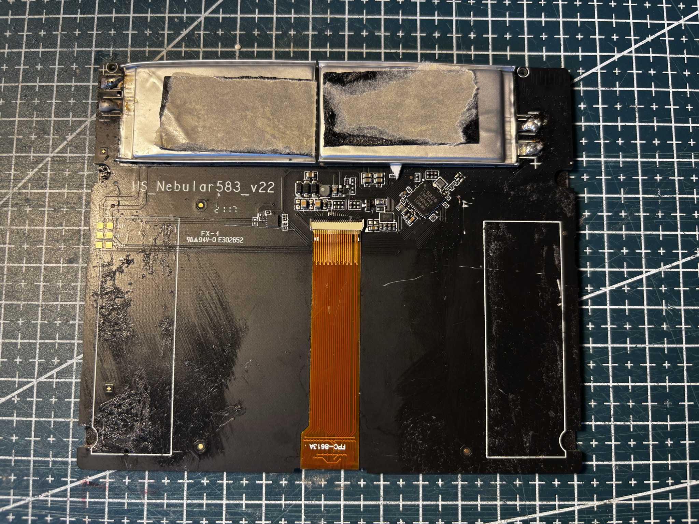
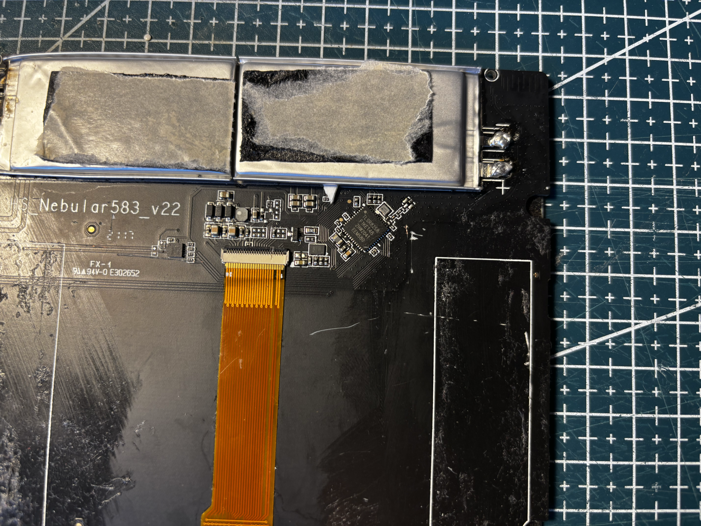
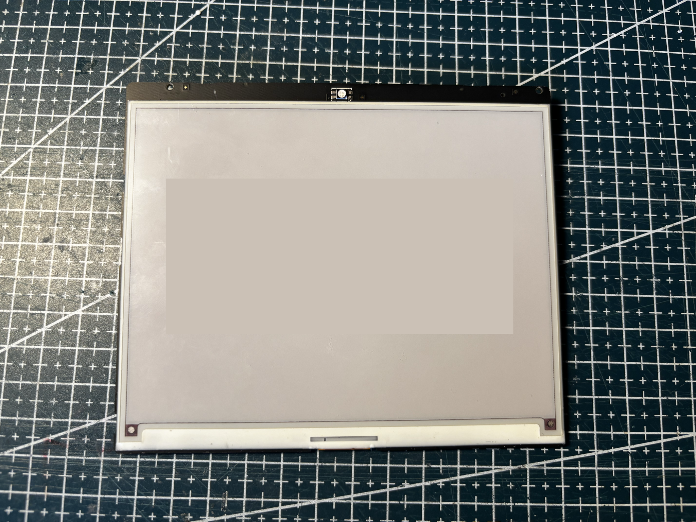

# HS-583-NEBULAR-BWR

Hanshow **Nebular** 5.83" class tag, black housing.

## Identity

|         |                                                                                 |
| ------- | ------------------------------------------------------------------------------- |
| Brand   | Hanshow                                                                         |
| Name    | Nebular                                                                         |
| Housing | black                                                                           |
| Panel   | [HINK-E0583A01](../../../screens/583/BWR/HINK-E0583A01/README.md), BWR, 648×480 |

Details in [doc/references.md](doc/references.md).

## Panel

Same resolution family as the [Stellar 583](HS-583-STELLAR-BWR/README.md) panel page (**HINK-E0583A01**).

## Reuse

For panel extraction, start from the [HINK-E0583A01](../../../screens/583/BWR/HINK-E0583A01/README.md) driver notes and [Stellar example](../HS-583-STELLAR-BWR/code/panel.ino).

## References from photos

| Photo                                                                                | Extracted references                                                                                                                                                                                                            |
| ------------------------------------------------------------------------------------ | ------------------------------------------------------------------------------------------------------------------------------------------------------------------------------------------------------------------------------- |
|  | `2117` (PCB silkscreen / revision); `E302652` (PCB silkscreen / revision); `FPC-8613A` (Flex / FPC part number); `HS_Nebular583_v22` (PCB silkscreen / revision); `TLSR8258 F1KET48 ZHW2041 EEM580` (PCB silkscreen / revision) |

## Photos

### Front

### PCB

### Screen

## Compatible third-party firmware

| Firmware                                                                              | Notes                                                   |
| ------------------------------------------------------------------------------------- | ------------------------------------------------------- |
| [OpenEPaperLink](https://github.com/OpenEPaperLink/OpenEPaperLink)                    | Open-source ESL access point and tag firmware ecosystem |
| [ATC BLE OEPL image upload](https://atc1441.github.io/ATC_BLE_OEPL_Image_Upload.html) | Flash OpenEPaperLink on supported Hanshow tags over BLE |

## Acknowledgements

Thanks to the [OpenEPaperLink](https://github.com/OpenEPaperLink/OpenEPaperLink) team, and to [atc1441](https://github.com/atc1441) for the Hanshow BLE path and the [ATC BLE OEPL image upload](https://atc1441.github.io/ATC_BLE_OEPL_Image_Upload.html) tool.
