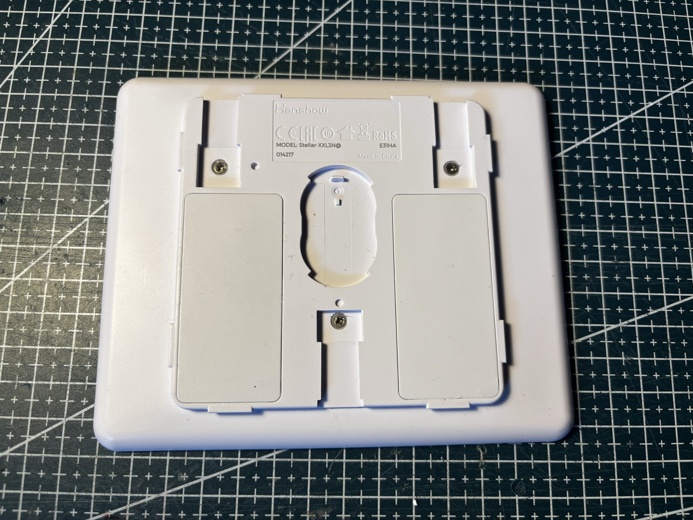
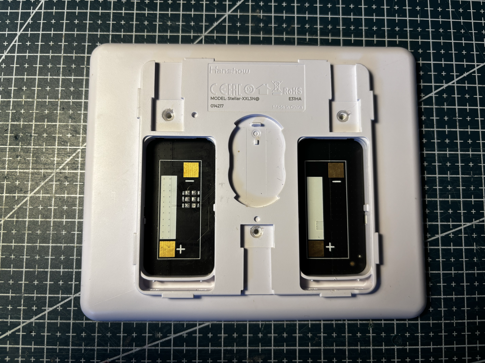
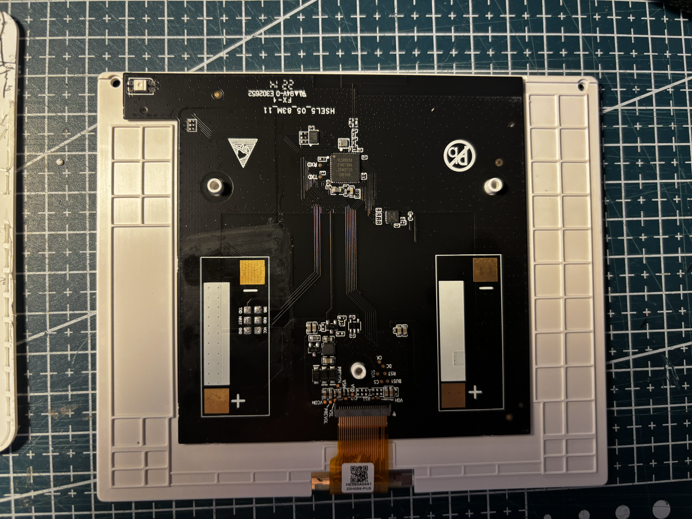
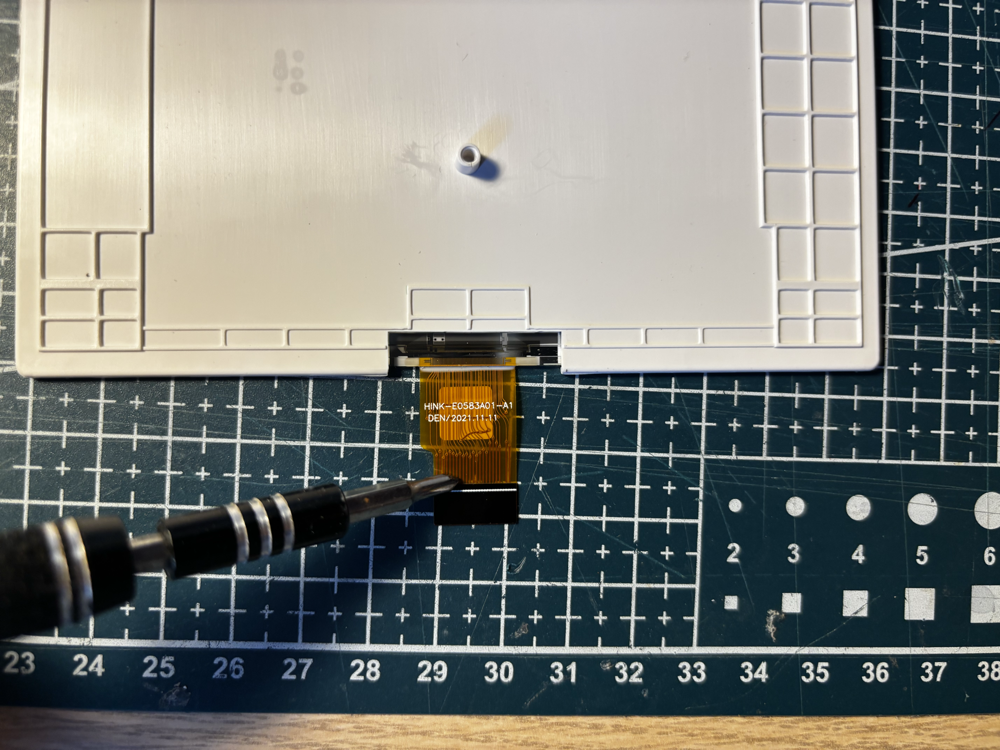
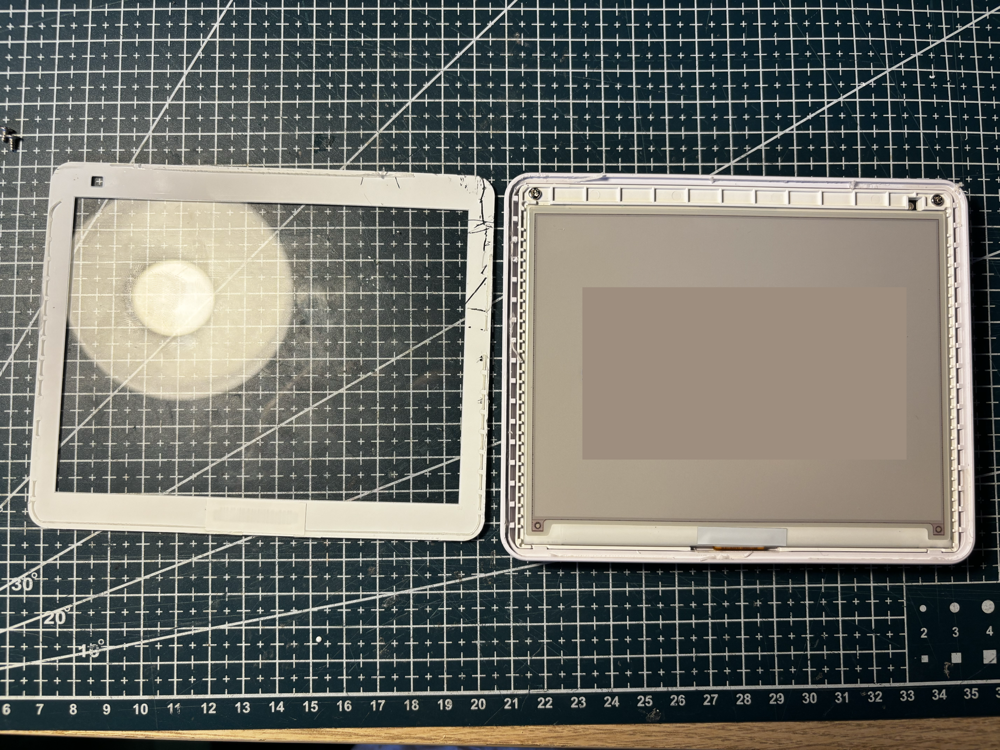
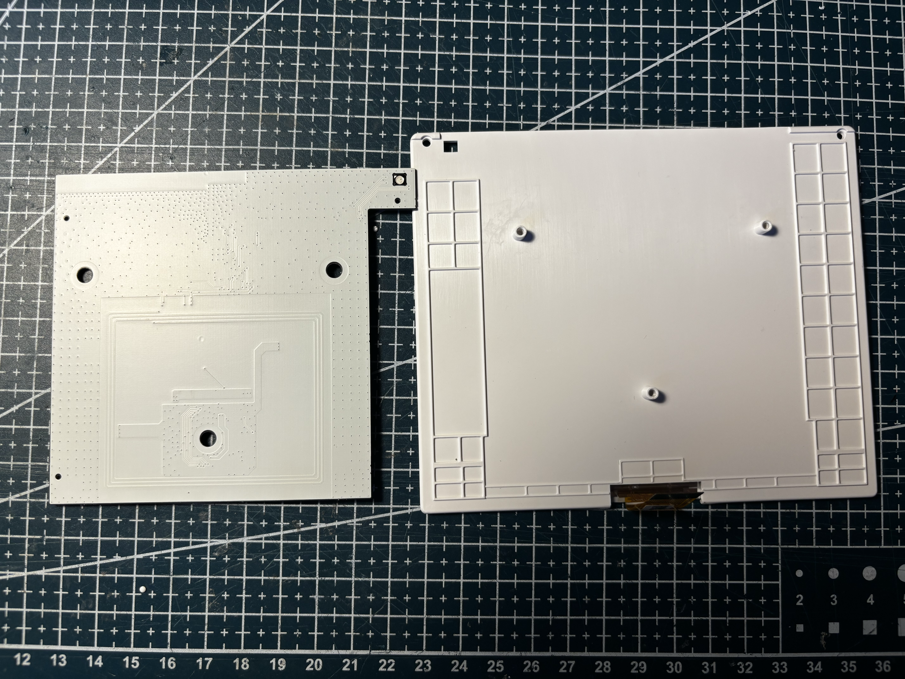

# HS-583-STELLAR-BWR

Hanshow **Stellar** 5.83", white housing.


## Identity

|         |                                                                                 |
| ------- | ------------------------------------------------------------------------------- |
| Brand   | Hanshow                                                                         |
| Name    | Stellar                                                                         |
| Model   | Stellar-XXL3N@                                                                  |
| Housing | white                                                                           |
| Panel   | [HINK-E0583A01](../../../screens/583/BWR/HINK-E0583A01/README.md), BWR, 648×480 |

Details in [doc/references.md](doc/references.md).

## Panel

Flex **HINK-E0583A01**, controller **GD7965**. Driver `GxEPD2_583c_Z83`. Use full 648×480 canvas (`GFXcanvas1` + `drawImage`)—**never** HEIGHT/2 paging on this panel. Full refresh about 25 s.

## Reuse

```cpp
#include <GxEPD2_3C.h>

GxEPD2_3C<GxEPD2_583c_Z83, GxEPD2_583c_Z83::HEIGHT> display(
    GxEPD2_583c_Z83(/*CS*/ 5, /*DC*/ 17, /*RST*/ 16, /*BUSY*/ 4));

void setup() {
  display.init(115200);
  display.setRotation(0);
  display.setFullWindow();
  display.firstPage();
  do {
    display.fillScreen(GxEPD_WHITE);
  } while (display.nextPage());
}
```

See [code/panel.ino](code/panel.ino).

## References from photos

| Photo                                                                                      | Extracted references                                                                                                                                                                                                                                                                                                                                                                       |
| ------------------------------------------------------------------------------------------ | ------------------------------------------------------------------------------------------------------------------------------------------------------------------------------------------------------------------------------------------------------------------------------------------------------------------------------------------------------------------------------------------ |
|      | `014217` (Date code / lot); `E31HA` (Date code / lot); `Hanshow` (Brand or vendor name); `MODEL: Stellar-XXL3N@` (ESL tag model / SKU)                                                                                                                                                                                                                                                     |
|  | `014217` (Date code / lot); `E31HA` (Date code / lot); `Hanshow` (Brand or vendor name); `MODEL: Stellar-XXL3N@` (ESL tag model / SKU)                                                                                                                                                                                                                                                     |
|  | `22H059-PU5` (Date code / lot); `C8T6` (MCU / radio module marking); `E302652` (PCB silkscreen / revision); `EGF698` (MCU / radio module marking); `F1KET48A` (Date code / lot); `FX-1` (PCB silkscreen / revision); `HE583A04A1` (Flex / FPC part number); `HSEL5_05_83M_11` (PCB silkscreen / revision); `TLSR8258` (PCB silkscreen / revision); `ZTAK2123` (MCU / radio module marking) |
|  | `DEN/2021.11.11` (Date code / lot); `HINK-E0583A01-A1` (Panel module / glass ID)                                                                                                                                                                                                                                                                                                           |

## Photos

### Front


### Back


### Open





### Pinout


### Screen


## Compatible third-party firmware

| Firmware                                                                              | Notes                                                   |
| ------------------------------------------------------------------------------------- | ------------------------------------------------------- |
| [OpenEPaperLink](https://github.com/OpenEPaperLink/OpenEPaperLink)                    | Open-source ESL access point and tag firmware ecosystem |
| [ATC BLE OEPL image upload](https://atc1441.github.io/ATC_BLE_OEPL_Image_Upload.html) | Flash OpenEPaperLink on supported Hanshow tags over BLE |

## Acknowledgements

Thanks to the [OpenEPaperLink](https://github.com/OpenEPaperLink/OpenEPaperLink) team, and to [atc1441](https://github.com/atc1441) for the Hanshow BLE path and the [ATC BLE OEPL image upload](https://atc1441.github.io/ATC_BLE_OEPL_Image_Upload.html) tool.
