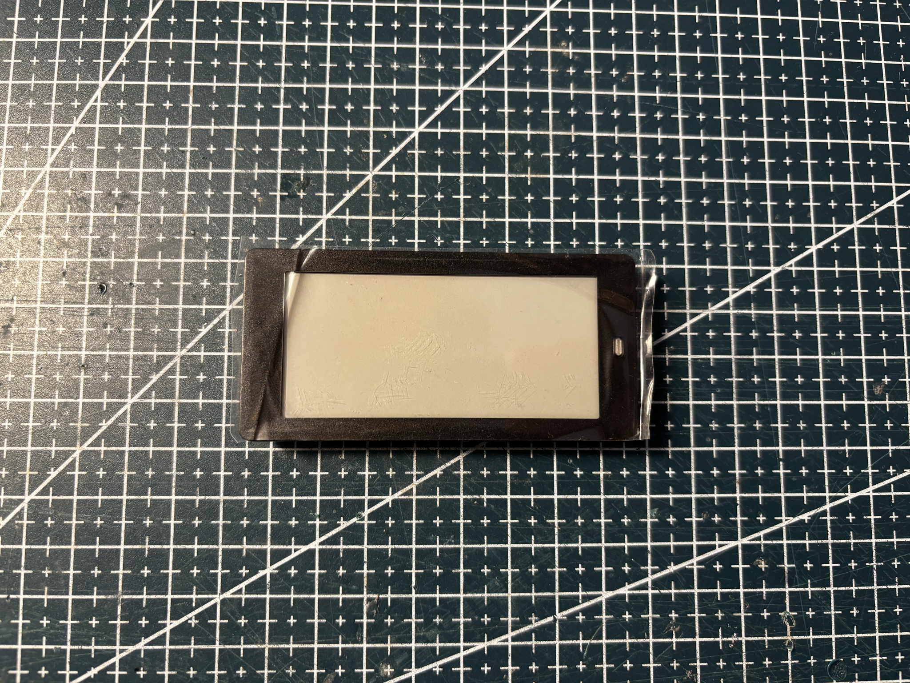
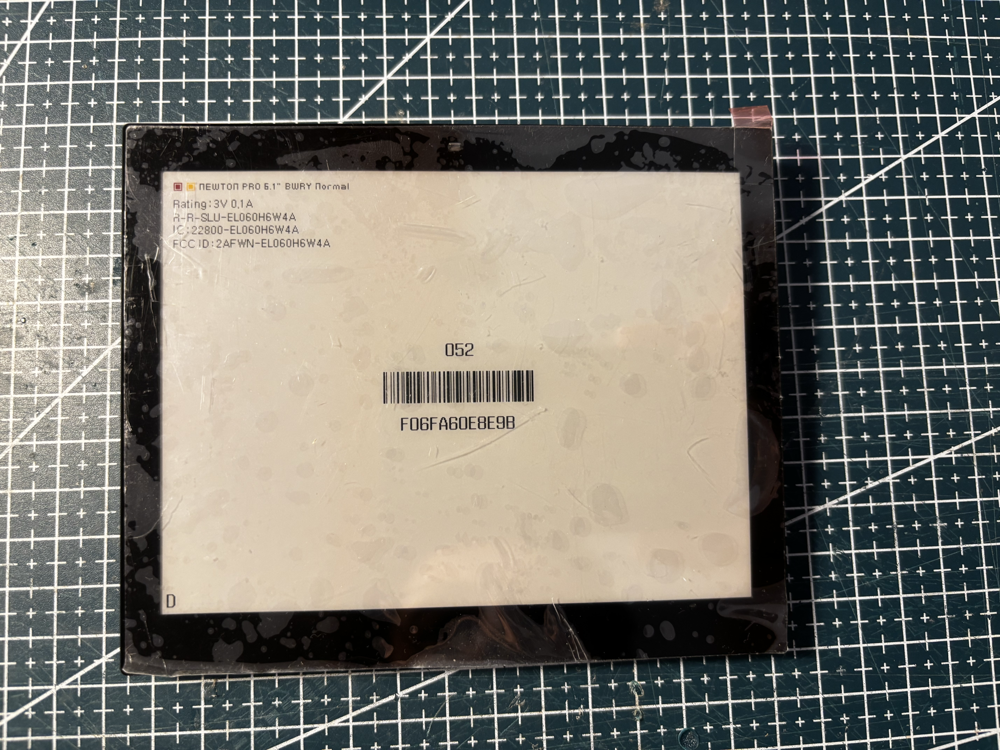
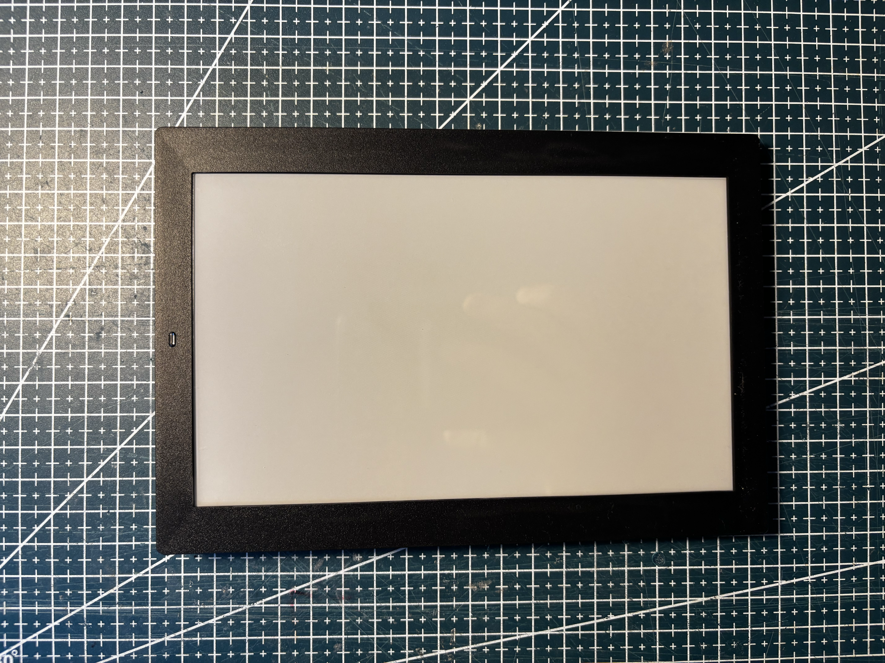

# Solum

| Tag                                                                                                  | Product               | Model      | Panel                                                           |
| ---------------------------------------------------------------------------------------------------- | --------------------- | ---------- | --------------------------------------------------------------- |
|                 | 2.8 BK, black housing | EL028R8B4C | [HINK-E0276A01](../../screens/280/BWRY/HINK-E0276A01/README.md) |
|  | Newton Pro 6.1" BWRY  | EL060H6W4A | [FPC-8629](../../screens/610/BWRY/FPC-8629/README.md)           |
|                 | 7.5 BK, black housing | ELM75R8B4C | [FPC-7909](../../screens/750/BWRY/FPC-7909/README.md)           |

## Compatible third-party firmware

These Solum tags are not supported by [OpenEPaperLink](https://github.com/OpenEPaperLink/OpenEPaperLink) by default yet. Each tag page names the firmware that still needs work.
