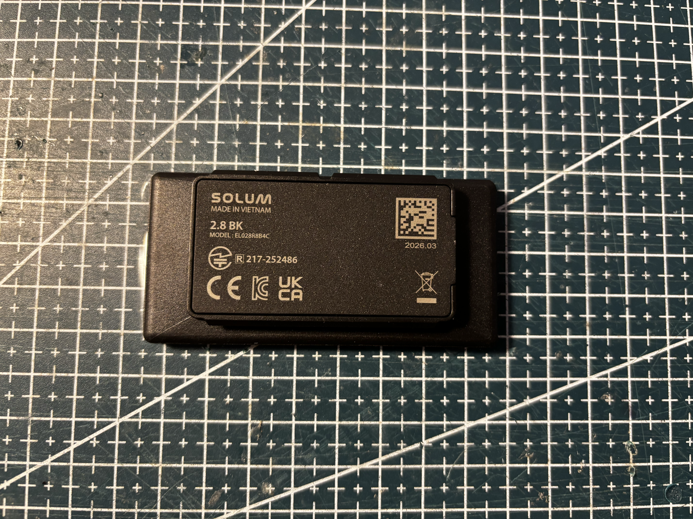
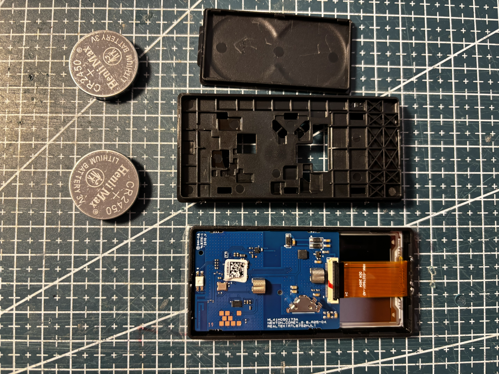
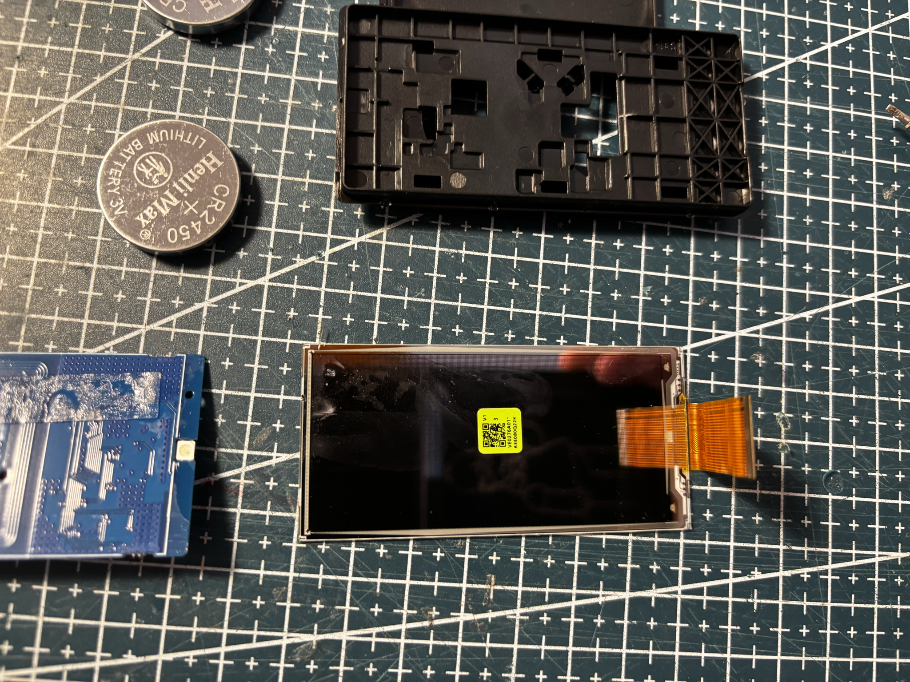
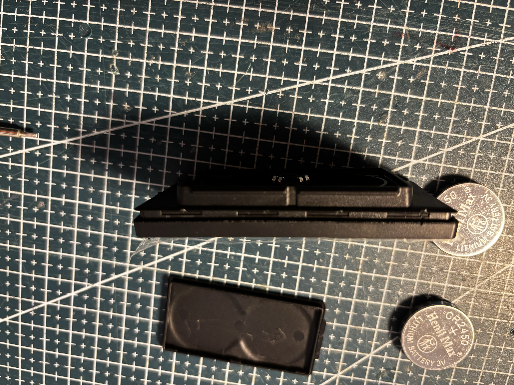
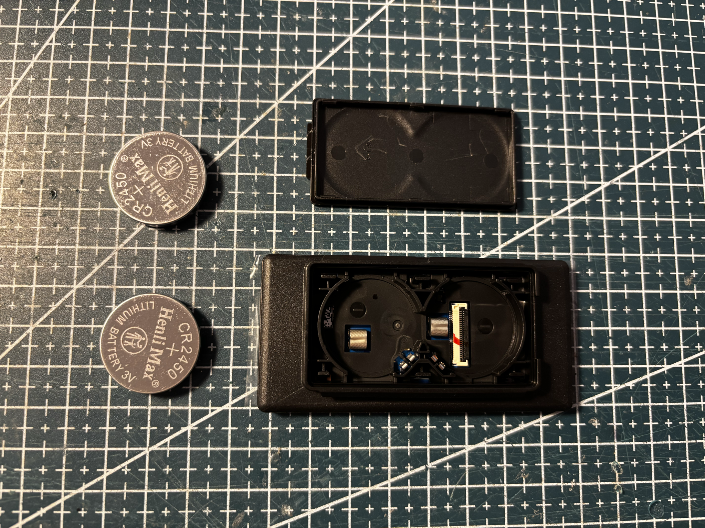
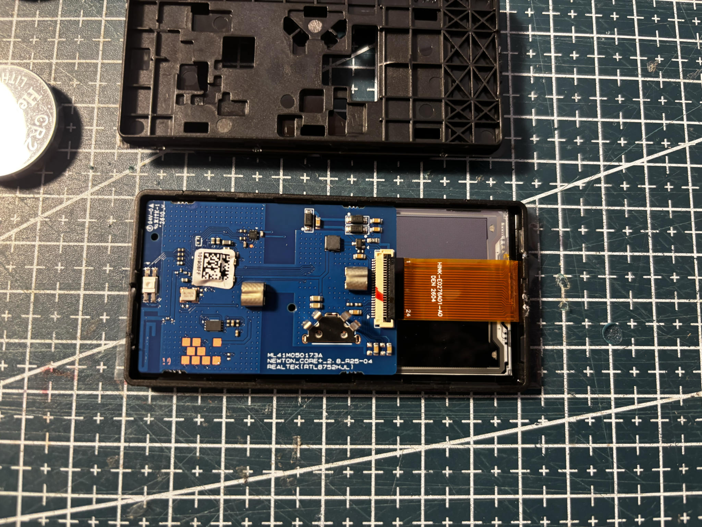
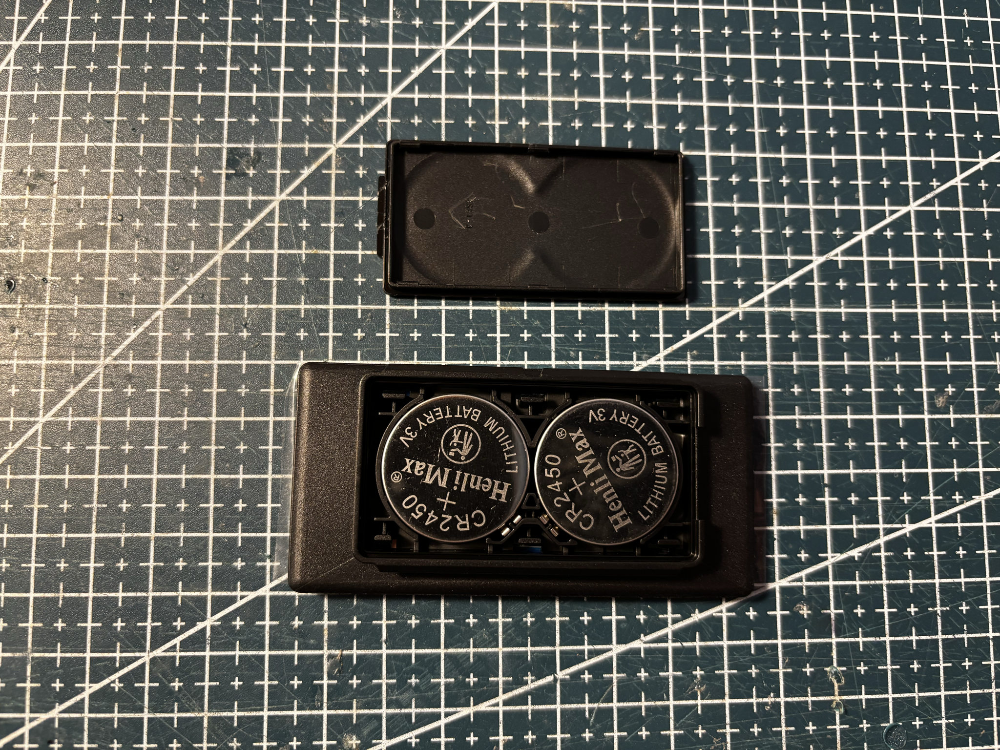
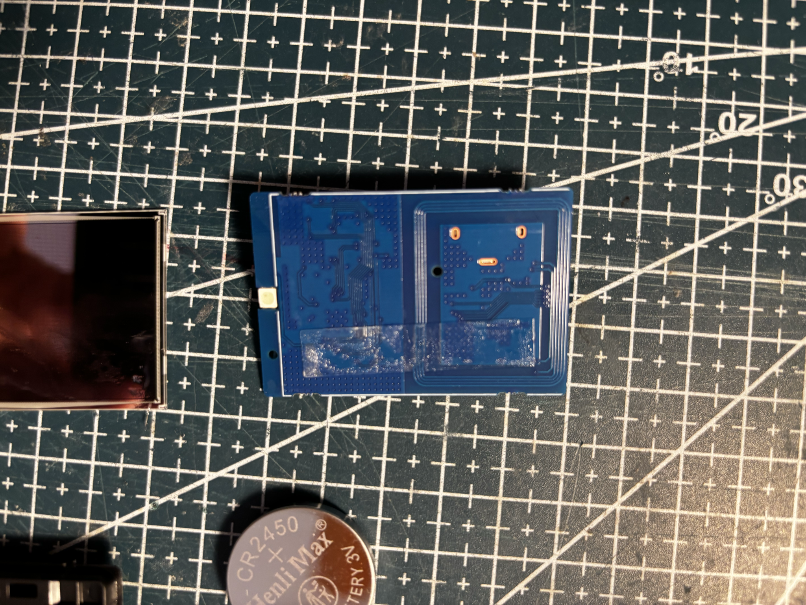
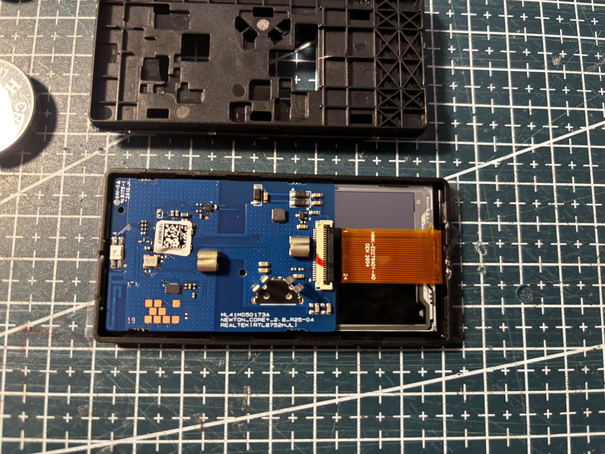

# SL-28-BK-280-BWRY

Solum **2.8 BK**, black housing.


## Identity

|         |                                                                                   |
| ------- | --------------------------------------------------------------------------------- |
| Brand   | Solum                                                                             |
| Name    | 2.8 BK                                                                            |
| Model   | EL028R8B4C                                                                        |
| Housing | black                                                                             |
| Panel   | [HINK-E0276A01](../../../screens/280/BWRY/HINK-E0276A01/README.md), BWRY, 296×128 |

Details in [doc/references.md](doc/references.md).

## Panel

Panel removed from this tag. Flex marked **HINK-E0276A01-A0**, **DEN 2604**, and **VE0276A01**. Active area about 64 × 30 mm. Usable resolution **296×128**, four colors.

Panel controller **SSD2680ZA**. Driver used: `GxEPD2_276c_E0276A01` (custom class, not in upstream GxEPD2).

## Reuse

```cpp
#include <GxEPD2_4C.h>

// Custom class (SSD2680ZA). Not in upstream GxEPD2.
GxEPD2_4C<GxEPD2_276c_E0276A01, GxEPD2_276c_E0276A01::HEIGHT> display(
    GxEPD2_276c_E0276A01(/*CS*/ 5, /*DC*/ 17, /*RST*/ 16, /*BUSY*/ 4));

void setup() {
  display.init(115200);
  display.setRotation(1); // native 128x296 -> 296x128
  display.setFullWindow();
  display.firstPage();
  do {
    display.fillScreen(GxEPD_WHITE);
  } while (display.nextPage());
}
```

See [code/panel.ino](code/panel.ino).

<!-- photo-refs:start -->

## References from photos

| Photo                                                                                                                                      | Extracted references                                                                                                                                                                                                                                                    |
| ------------------------------------------------------------------------------------------------------------------------------------------ | ----------------------------------------------------------------------------------------------------------------------------------------------------------------------------------------------------------------------------------------------------------------------- |
| [](pictures/SL-28-BK-280-BWRY-black-back-01.png)       | `2.8 BK` (ESL tag model / SKU); `EL028R8B4C` (ESL tag model / SKU); `R 217-252486` (FCC / IC / CE / UKCA text); `SOLUM` (Brand or vendor name)                                                                                                                          |
| [](pictures/SL-28-BK-280-BWRY-black-open-02.png)       | `101908FF` (PCB silkscreen / revision); `DEN 2604` (Date code / lot); `HINK-E0276A01-A0` (Flex / FPC part number); `ML41M050173A` (PCB silkscreen / revision); `NEWTON_CORE+_2.9_R25-04` (PCB silkscreen / revision); `REALTEK RTL8752HJL` (MCU / radio module marking) |
| [](pictures/SL-28-BK-280-BWRY-black-screen-02.png) | `63E080Q22K` (Brand or vendor name); `VE0276A01` (Barcode / serial / MAC)                                                                                                                                                                                               |

<!-- photo-refs:end -->

## Photos

### Front


### Back


### Side



### Open






### Battery



### PCB



### Pinout



### Screen


## Compatible third-party firmware

Not supported by default yet. This tag still needs work before it can be added to OpenEPaperLink.

| Firmware                                                           | Notes                                                         |
| ------------------------------------------------------------------ | ------------------------------------------------------------- |
| [OpenEPaperLink](https://github.com/OpenEPaperLink/OpenEPaperLink) | Target ecosystem. This model is not supported out of the box. |
| [ATC_RTL_BLE_OEPL](https://github.com/atc1441/ATC_RTL_BLE_OEPL)    | Intended tag firmware. Not yet adapted for this 2.8" unit.    |

## Acknowledgements

Thanks to the [OpenEPaperLink](https://github.com/OpenEPaperLink/OpenEPaperLink) team, and to [atc1441](https://github.com/atc1441) for [ATC_RTL_BLE_OEPL](https://github.com/atc1441/ATC_RTL_BLE_OEPL).
