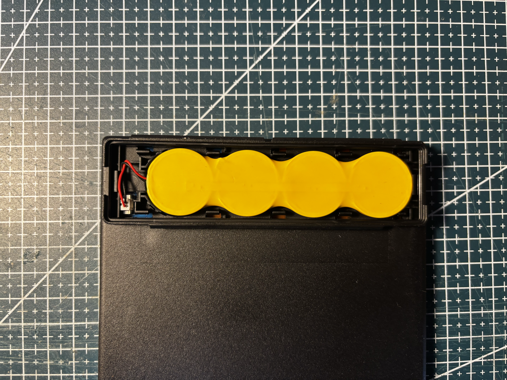
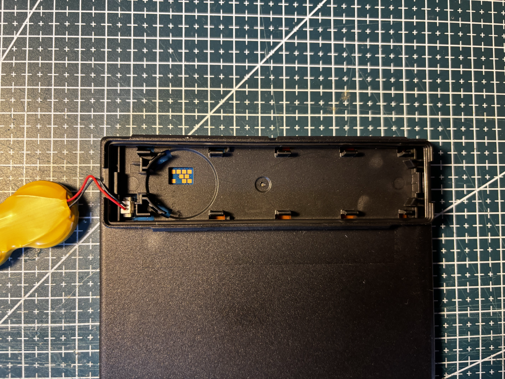
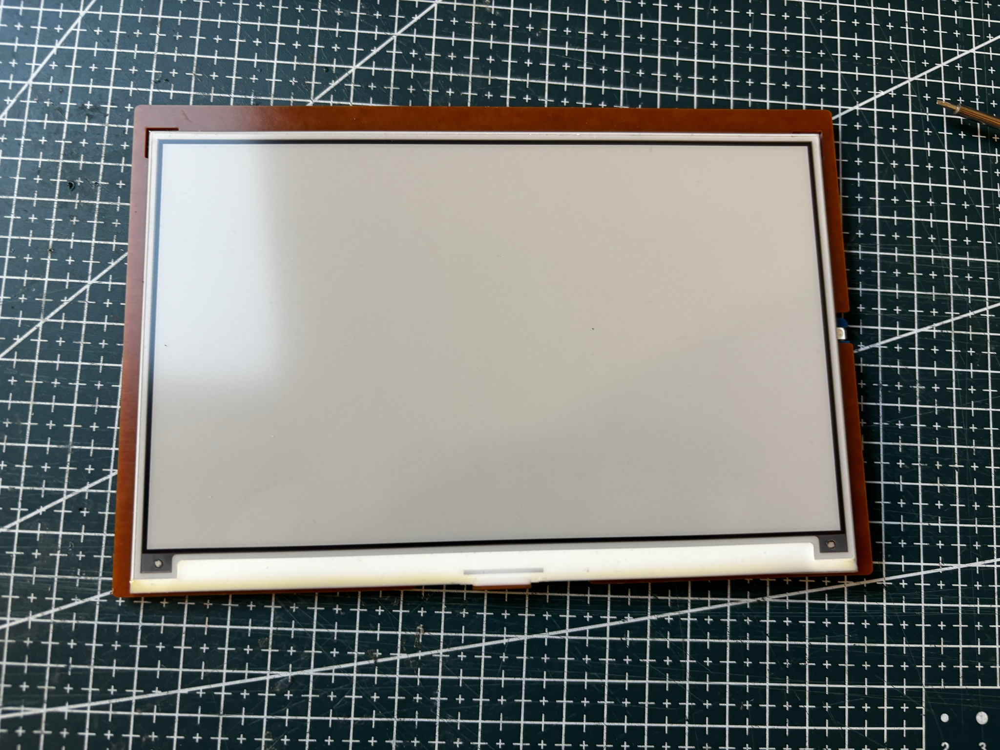
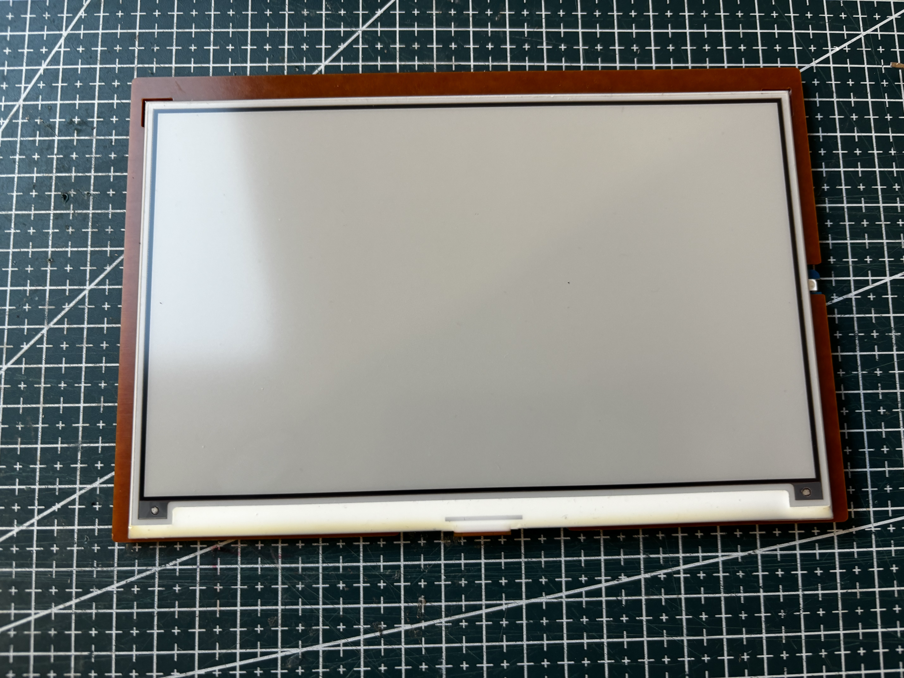
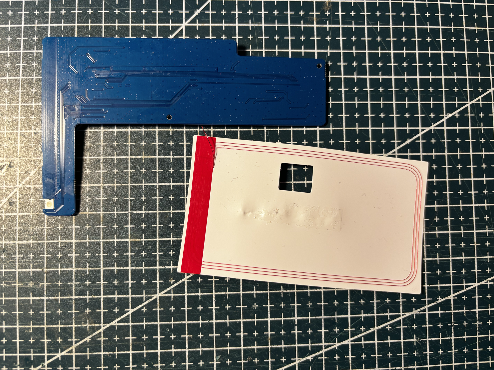

# SL-75-BK-750-BWRY

Solum **7.5 BK**, black housing. Large four-color retail tag.


## Identity

|         |                                                                         |
| ------- | ----------------------------------------------------------------------- |
| Brand   | Solum                                                                   |
| Name    | 7.5 BK                                                                  |
| Model   | ELM75R8B4C                                                              |
| Housing | black                                                                   |
| Panel   | [FPC-7909](../../../screens/750/BWRY/FPC-7909/README.md), BWRY, 800×480 |

Details in [doc/references.md](doc/references.md).

## Panel

**800×480**, four colors, controller **JD79665AA**.

## Reuse

```cpp
#include <GxEPD2_4C.h>

// JD79665AA, in upstream GxEPD2.
GxEPD2_4C<GxEPD2_750c_GDEM075F52, GxEPD2_750c_GDEM075F52::HEIGHT> display(
    GxEPD2_750c_GDEM075F52(/*CS*/ 5, /*DC*/ 17, /*RST*/ 16, /*BUSY*/ 4));

void setup() {
  display.init(115200);
  display.setRotation(0); // 800x480
  display.setFullWindow();
  display.firstPage();
  do {
    display.fillScreen(GxEPD_WHITE);
  } while (display.nextPage());
}
```

See [code/panel.ino](code/panel.ino).

## References from photos

| Photo                                                                                      | Extracted references                                                                                                                                                                                                                       |
| ------------------------------------------------------------------------------------------ | ------------------------------------------------------------------------------------------------------------------------------------------------------------------------------------------------------------------------------------------ |
|  | `Lithium Battery 3V` (Battery model); `Omnergy CR2450-4P` (Battery model); `PC:2549` (Other useful string)                                                                                                                                 |
|      | `7.5 BK` (ESL tag model / SKU); `ELM75R8B4C` (ESL tag model / SKU); `SOLUM` (Brand or vendor name)                                                                                                                                         |
|          | `2025/04/18` (Date code / lot); `2552` (Date code / lot); `7.5_TAG_3C4C_R03` (PCB silkscreen / revision); `E351305` (FCC / IC / CE / UKCA text); `NEWTON_CORE_PLUS` (PCB silkscreen / revision)                                            |
|    | `2025/04/18` (Date code / lot); `2552` (Date code / lot); `7.5_TAG_3C4C_R03` (PCB silkscreen / revision); `94V-0 SG1-H` (FCC / IC / CE / UKCA text); `E351205` (FCC / IC / CE / UKCA text); `NEWTON_CORE_PLUS` (PCB silkscreen / revision) |

## Photos

### Front


### Label


### Battery




### PCB


### Pinout




### Screen








## Compatible third-party firmware

Not supported by default yet. This tag still needs work before it can be added to OpenEPaperLink.

| Firmware                                                           | Notes                                                         |
| ------------------------------------------------------------------ | ------------------------------------------------------------- |
| [OpenEPaperLink](https://github.com/OpenEPaperLink/OpenEPaperLink) | Target ecosystem. This model is not supported out of the box. |
| [ATC_RTL_BLE_OEPL](https://github.com/atc1441/ATC_RTL_BLE_OEPL)    | Intended tag firmware. Not yet adapted for this 7.5" unit.    |

## Acknowledgements

Thanks to the [OpenEPaperLink](https://github.com/OpenEPaperLink/OpenEPaperLink) team, and to [atc1441](https://github.com/atc1441) for [ATC_RTL_BLE_OEPL](https://github.com/atc1441/ATC_RTL_BLE_OEPL).
