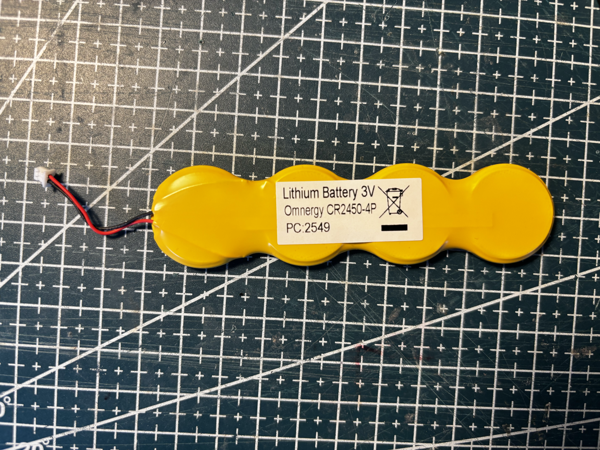
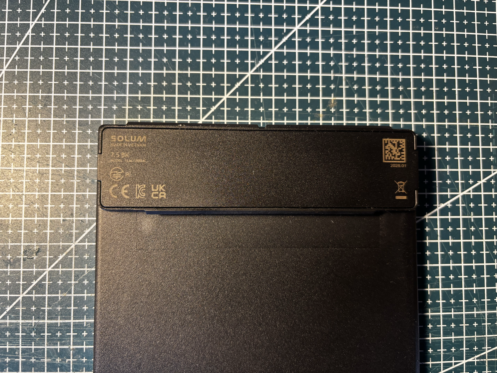
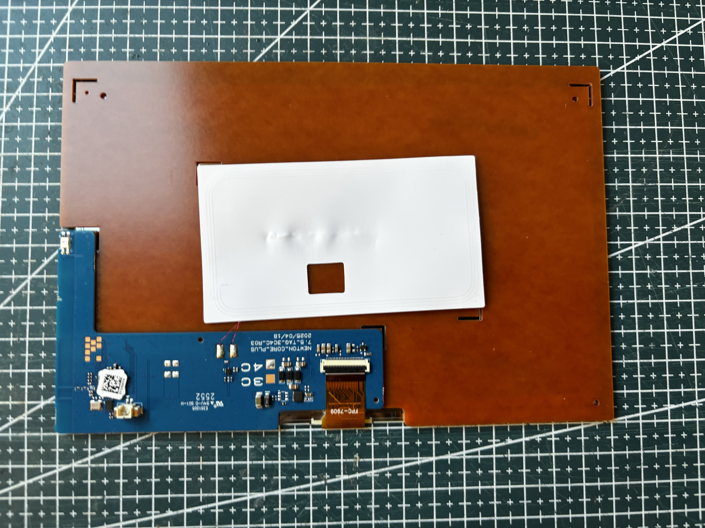
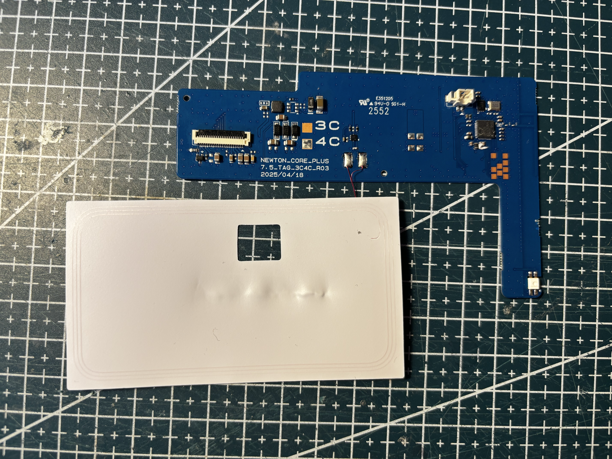

# References — SL-75-BK-750-BWRY

## Markings

- SOLUM, MADE IN VIETNAM
- 7.5 BK
- MODEL ELM75R8B4C
- date 2026.01
- CE, KC, UKCA
- WEEE crossed-bin symbol

Board: `NEWTON_CORE_PLUS`, `7.5_TAG_3C4C_R03`, `2025/04/18`. Flex: `FPC-7909`.

## References from photos

| Photo                                                                                         | Extracted references                                                                                                                                                                                                                       |
| --------------------------------------------------------------------------------------------- | ------------------------------------------------------------------------------------------------------------------------------------------------------------------------------------------------------------------------------------------ |
|  | `Lithium Battery 3V` (Battery model); `Omnergy CR2450-4P` (Battery model); `PC:2549` (Other useful string)                                                                                                                                 |
|      | `7.5 BK` (ESL tag model / SKU); `ELM75R8B4C` (ESL tag model / SKU); `SOLUM` (Brand or vendor name)                                                                                                                                         |
|          | `2025/04/18` (Date code / lot); `2552` (Date code / lot); `7.5_TAG_3C4C_R03` (PCB silkscreen / revision); `E351305` (FCC / IC / CE / UKCA text); `NEWTON_CORE_PLUS` (PCB silkscreen / revision)                                            |
|    | `2025/04/18` (Date code / lot); `2552` (Date code / lot); `7.5_TAG_3C4C_R03` (PCB silkscreen / revision); `94V-0 SG1-H` (FCC / IC / CE / UKCA text); `E351205` (FCC / IC / CE / UKCA text); `NEWTON_CORE_PLUS` (PCB silkscreen / revision) |
