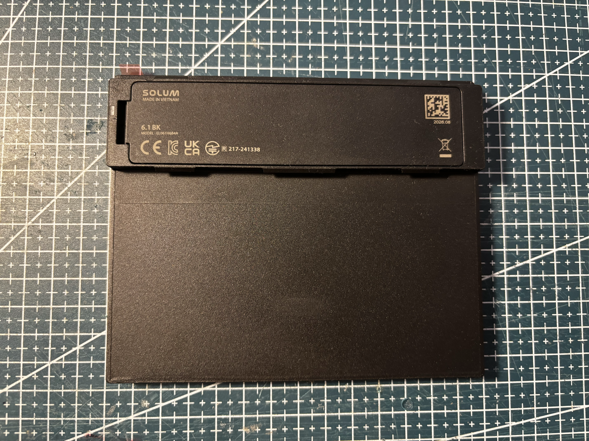
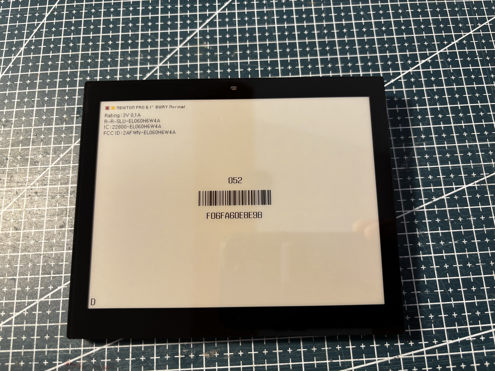
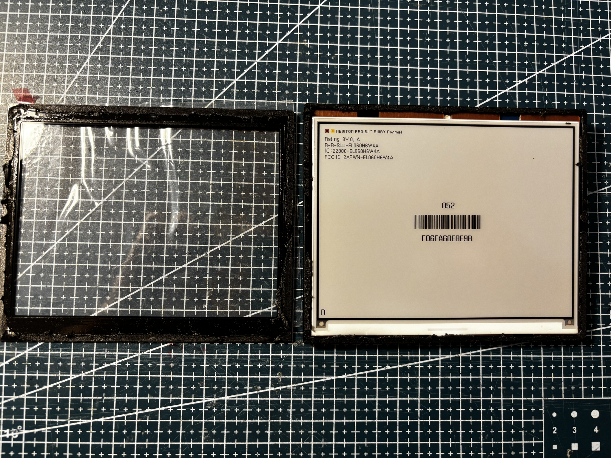
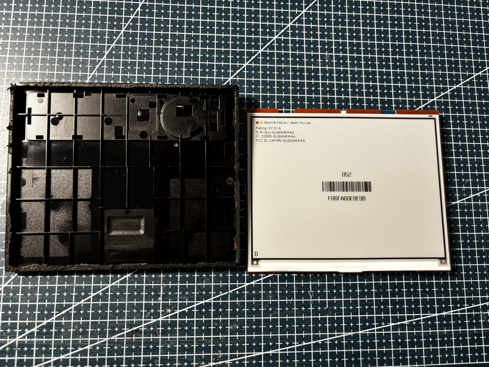
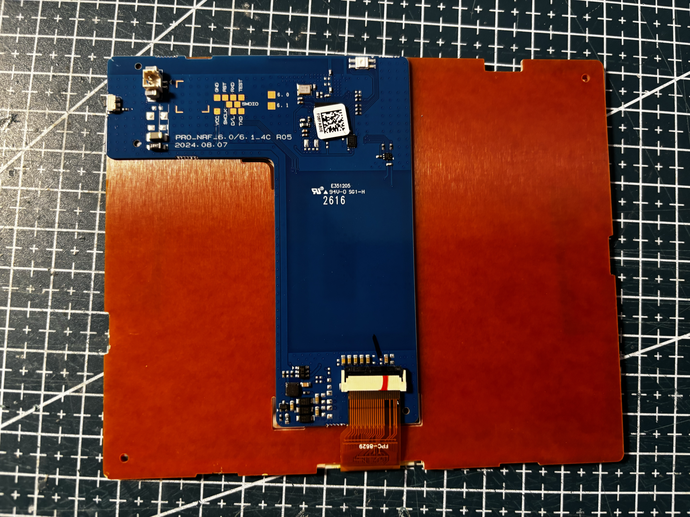
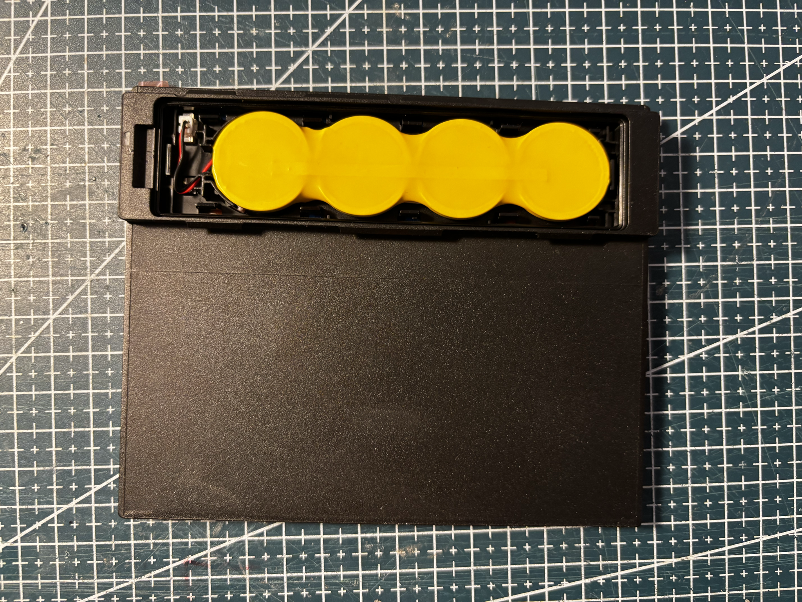
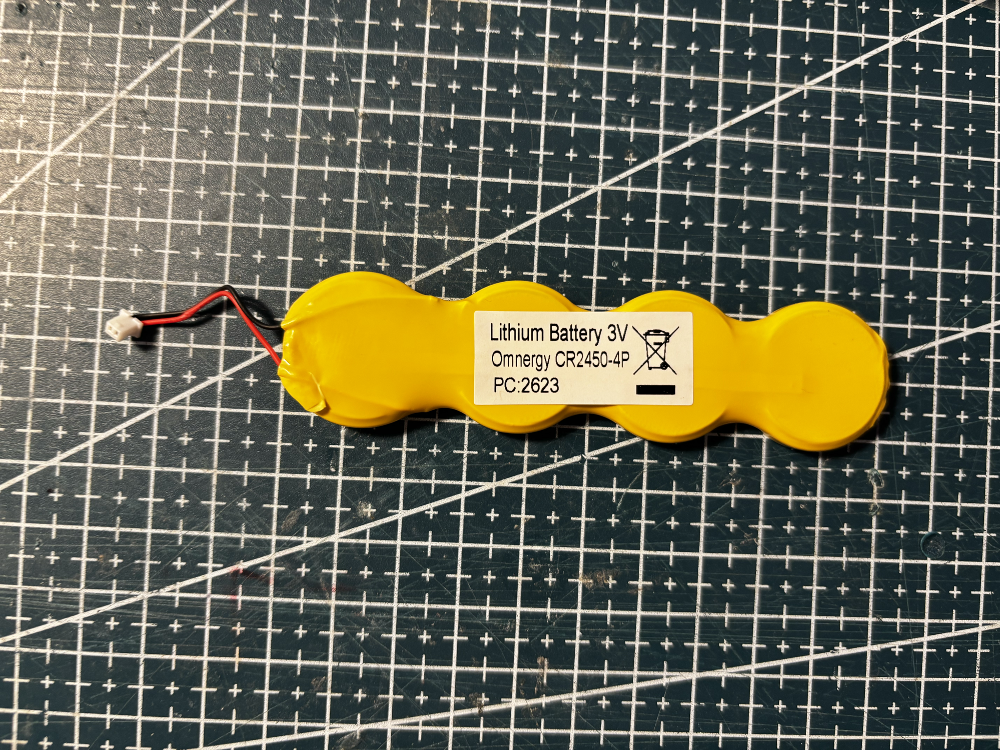
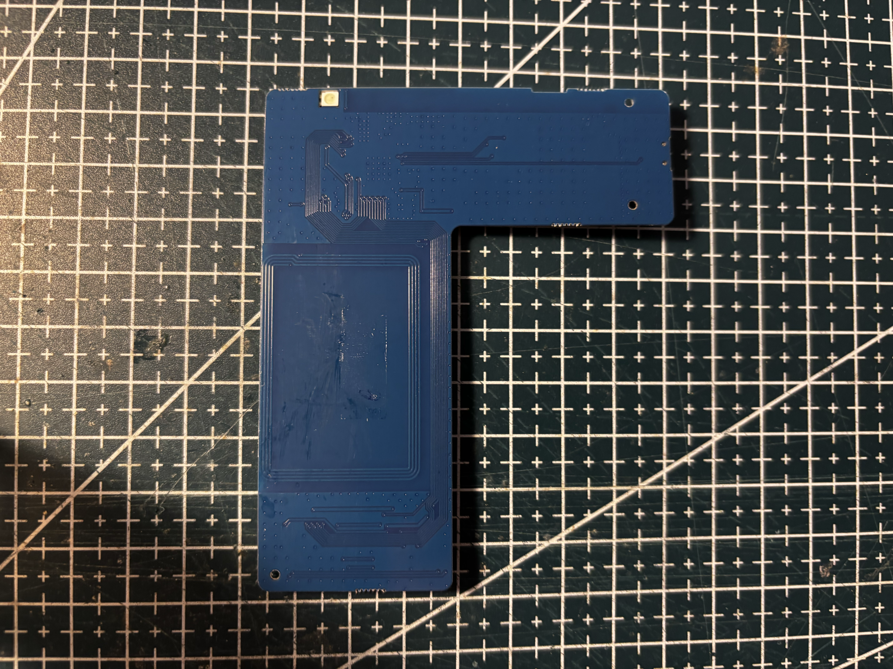
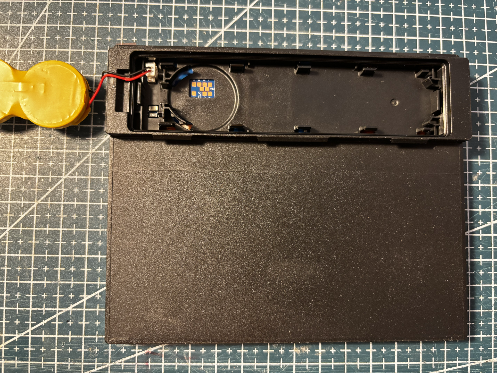
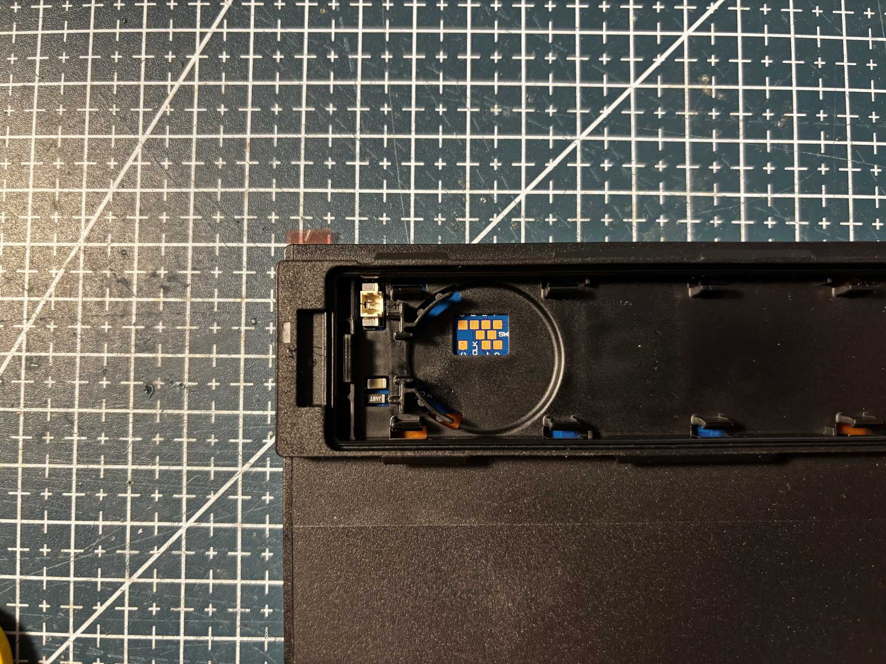

# SL-NEWTON-PRO-610-BWRY

Solum **Newton Pro 6.1" BWRY Normal**, black housing.


## Identity

|              |                                                                         |
| ------------ | ----------------------------------------------------------------------- |
| Brand        | Solum                                                                   |
| Name         | Newton Pro 6.1" BWRY Normal                                             |
| Model        | EL060H6W4A                                                              |
| Housing      | black                                                                   |
| Panel        | [FPC-8629](../../../screens/610/BWRY/FPC-8629/README.md), BWRY, 648×480 |

Details in [doc/references.md](doc/references.md).

## Panel

Four colors, **648×480**, about 118.8 × 88.2 mm, ~138 dpi. Controller **JD79665AA**.

Driver: `GxEPD2_611c_FPC8629` (custom class).

## Reuse

```cpp
#include <GxEPD2_4C.h>

// Custom class (JD79665AA, 8 px window offset).
GxEPD2_4C<GxEPD2_611c_FPC8629, GxEPD2_611c_FPC8629::HEIGHT> display(
    GxEPD2_611c_FPC8629(/*CS*/ 5, /*DC*/ 17, /*RST*/ 16, /*BUSY*/ 4));

void setup() {
  display.init(115200);
  display.setRotation(0); // 648x480
  display.setFullWindow();
  display.firstPage();
  do {
    display.fillScreen(GxEPD_WHITE);
  } while (display.nextPage());
}
```

See [code/panel.ino](code/panel.ino).

## References from photos

| Photo                                                                                              | Extracted references                                                                                                                                                                                                                                       |
| -------------------------------------------------------------------------------------------------- | ---------------------------------------------------------------------------------------------------------------------------------------------------------------------------------------------------------------------------------------------------------- |
|      | `6.1 BK` (ESL tag model / SKU); `MODEL : EL061H6B4A` (ESL tag model / SKU); `R 217-241338` (FCC / IC / CE / UKCA text); `SOLUM` (Brand or vendor name)                                                                                                     |
|    | `FCC ID: 2AFWN-EL060H6W4A` (FCC / IC / CE / UKCA text); `IC: 22800-EL060H6W4A` (FCC / IC / CE / UKCA text); `NEWTON PRO 6.1" BWRY Normal` (ESL tag model / SKU); `R-R-SLU-EL060H6W4A` (FCC / IC / CE / UKCA text); `Rating: 3V 0.1A` (Other useful string) |
|    | `FCC ID: 2AFWN-EL060H6W4A` (FCC / IC / CE / UKCA text); `IC: 22800-EL060H6W4A` (FCC / IC / CE / UKCA text); `NEWTON PRO 6.1" BWRY Normal` (ESL tag model / SKU); `R-R-SLU-EL060H6W4A` (FCC / IC / CE / UKCA text); `Rating: 3V 0.1A` (Other useful string) |
|      | `FCC ID: 2AFWN-EL060H6W4A` (FCC / IC / CE / UKCA text); `IC: 22800-EL060H6W4A` (FCC / IC / CE / UKCA text); `NEWTON PRO 6.1" BWRY Normal` (ESL tag model / SKU); `R-R-SLU-EL060H6W4A` (FCC / IC / CE / UKCA text); `Rating: 3V 0.1A` (Other useful string) |
|      | `FCC ID: 2AFWN-EL060H6W4A` (FCC / IC / CE / UKCA text); `IC: 22800-EL060H6W4A` (FCC / IC / CE / UKCA text); `NEWTON PRO 6.1" BWRY Normal` (ESL tag model / SKU); `R-R-SLU-EL060H6W4A` (FCC / IC / CE / UKCA text); `Rating: 3V 0.1A` (Other useful string) |
|  | `2024.08.07` (Date code / lot); `2616` (Date code / lot); `94V-0 SG1-H` (Other useful string); `E351205` (PCB silkscreen / revision); `FPC-8629` (Flex / FPC part number); `PRO_NRF_6.0/6.1_4C R05` (PCB silkscreen / revision)                            |
|  | `25BF11023701990` (Barcode / serial / MAC); `DEP60583RYF65CF25HP-S0` (Panel module / glass ID); `N2511P1J355-84-P020T-1` (Panel module / glass ID)                                                                                                         |
|  | `FCC ID: 2AFWN-EL060H6W4A` (FCC / IC / CE / UKCA text); `IC: 22800-EL060H6W4A` (FCC / IC / CE / UKCA text); `NEWTON PRO 6.1" BWRY Normal` (ESL tag model / SKU); `R-R-SLU-EL060H6W4A` (FCC / IC / CE / UKCA text); `Rating: 3V 0.1A` (Other useful string) |

## Photos

### Front


### Back


### Open


### Battery





### PCB



### Pinout






### Screen


## Compatible third-party firmware

Not supported by default yet. This tag still needs work before it can be added to OpenEPaperLink.

| Firmware                                                             | Notes                                                         |
| -------------------------------------------------------------------- | ------------------------------------------------------------- |
| [OpenEPaperLink](https://github.com/OpenEPaperLink/OpenEPaperLink)   | Target ecosystem. This model is not supported out of the box. |
| [Tag_FW_nRF52811](https://github.com/OpenEPaperLink/Tag_FW_nRF52811) | Intended tag firmware. Not yet adapted for this 6.1" unit.    |

## Acknowledgements

Thanks to the [OpenEPaperLink](https://github.com/OpenEPaperLink/OpenEPaperLink) team for [Tag_FW_nRF52811](https://github.com/OpenEPaperLink/Tag_FW_nRF52811).
