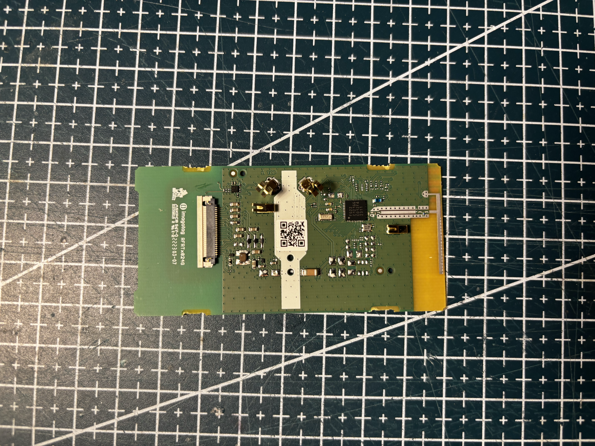
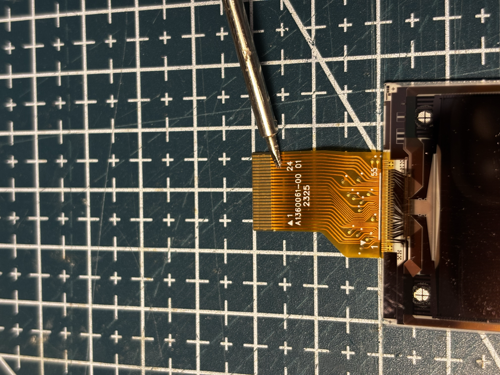
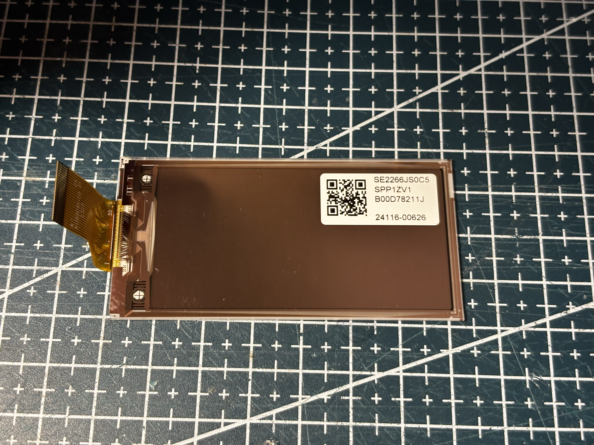
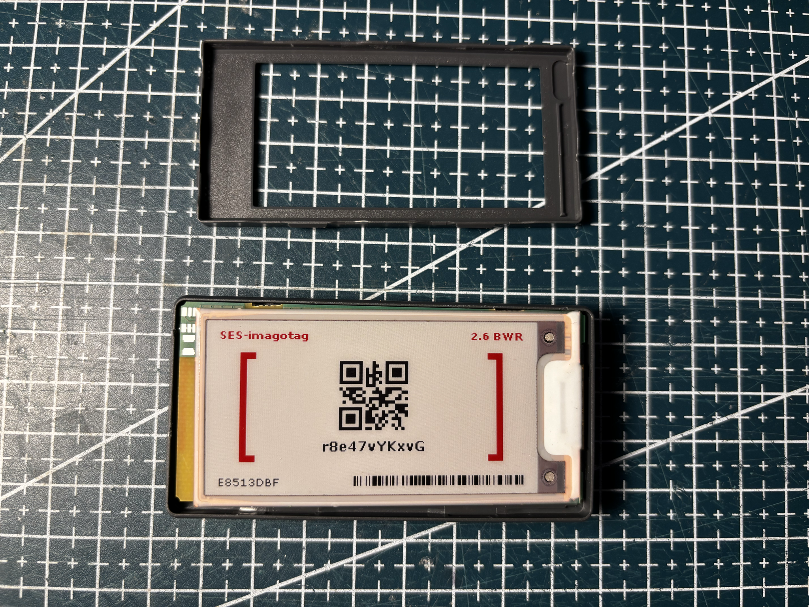
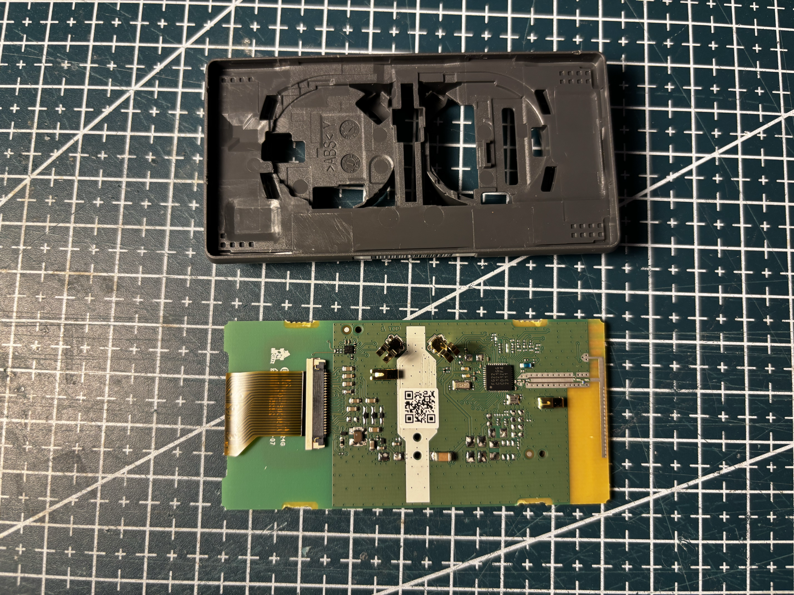
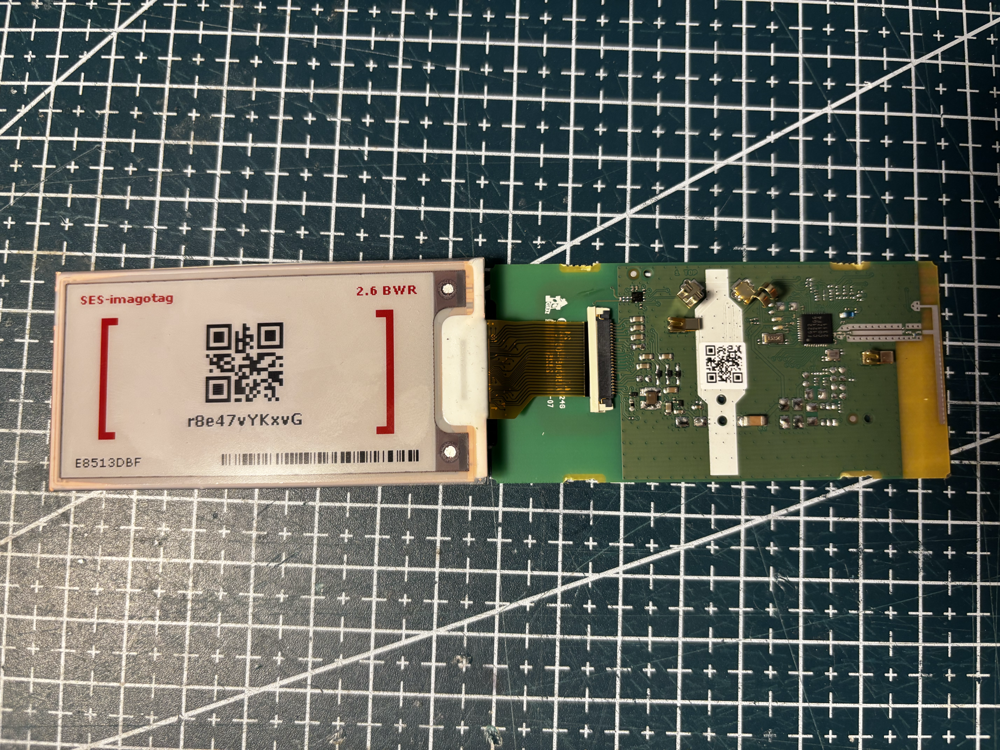
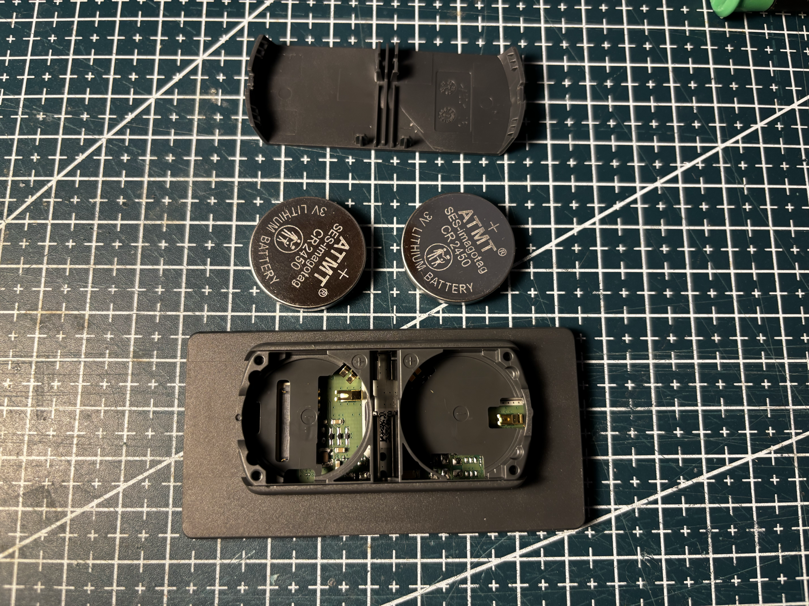
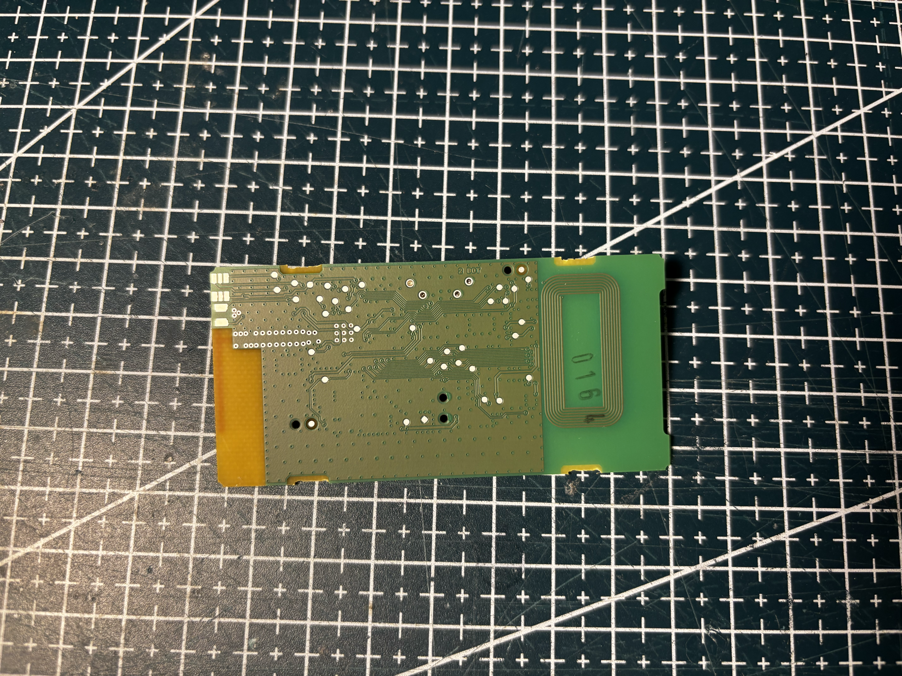

# VU-2.6-GU110-BWR

SES-imagotag / **Vusion** 2.6" class tag (Pervasive panel).


## Identity

|         |                                                                             |
| ------- | --------------------------------------------------------------------------- |
| Brand   | SES-imagotag / Vusion                                                       |
| Name    | 2.6 GU110                                                                   |
| Housing | gray                                                                        |
| Panel   | [SE2266JS0C5](../../../screens/266/BWR/SE2266JS0C5/README.md), BWR, 296×152 |

Details in [doc/references.md](doc/references.md).

## Panel

Pervasive **SE2266JS0C5** sticker on the panel back. Native **152×296**, `setRotation(3)` → **296×152**. Driver `GxEPD2_266c_SE2266JS0C5` (vendor Pervasive GxEPD2 fork).

## Reuse

```cpp
#include <GxEPD2_3C.h>

GxEPD2_3C<GxEPD2_266c_SE2266JS0C5, GxEPD2_266c_SE2266JS0C5::HEIGHT> display(
    GxEPD2_266c_SE2266JS0C5(/*CS*/ 5, /*DC*/ 17, /*RST*/ 16, /*BUSY*/ 4));

void setup() {
  display.init(115200);
  display.setRotation(3);
  display.setFullWindow();
  display.firstPage();
  do {
    display.fillScreen(GxEPD_WHITE);
  } while (display.nextPage());
}
```

See [code/panel.ino](code/panel.ino).

## References from photos

| Photo                                                                                | Extracted references                                                                                                                                          |
| ------------------------------------------------------------------------------------ | ------------------------------------------------------------------------------------------------------------------------------------------------------------- |
|        | `222303-07` (PCB silkscreen / revision); `imagotag` (Brand or vendor name); `RFRTx024G` (PCB silkscreen / revision)                                           |
|  | `2325` (Date code / lot); `A1360061-00 01` (Flex / FPC part number)                                                                                           |
|  | `24116-00626` (Panel module / glass ID); `B00D78211J` (Panel module / glass ID); `SE2266JS0C5` (Panel module / glass ID); `SPP1ZV1` (Panel module / glass ID) |

## Photos

### Front


### Open







### Battery



### PCB


### Pinout




### Screen


