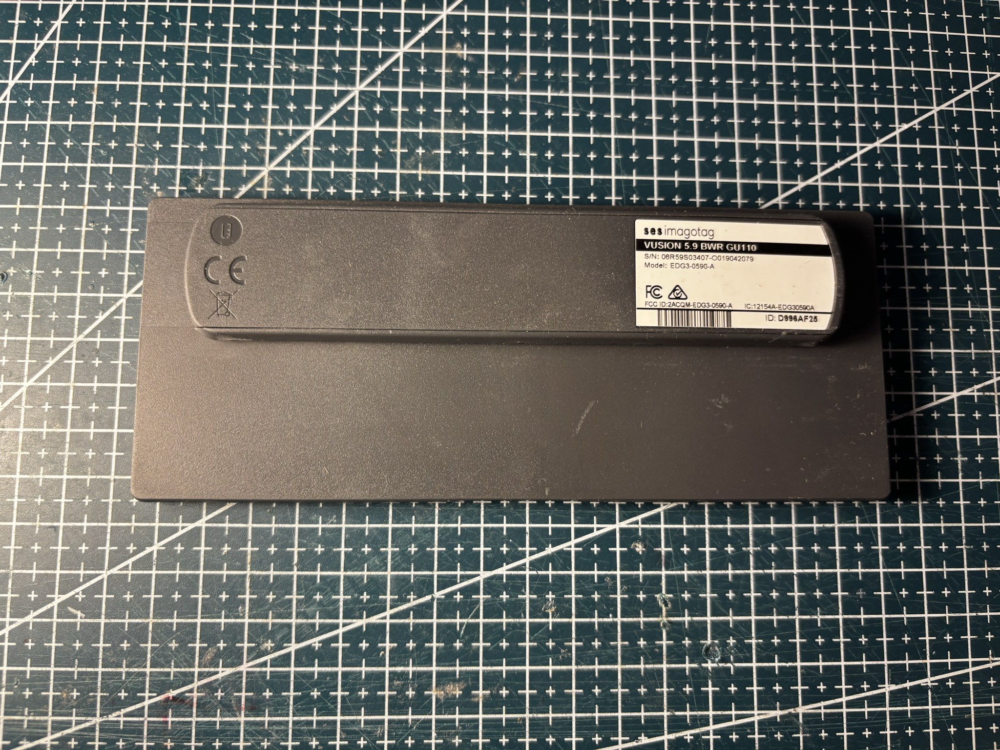
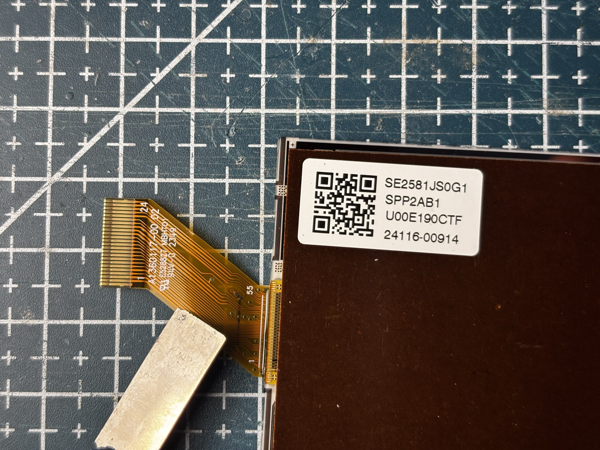
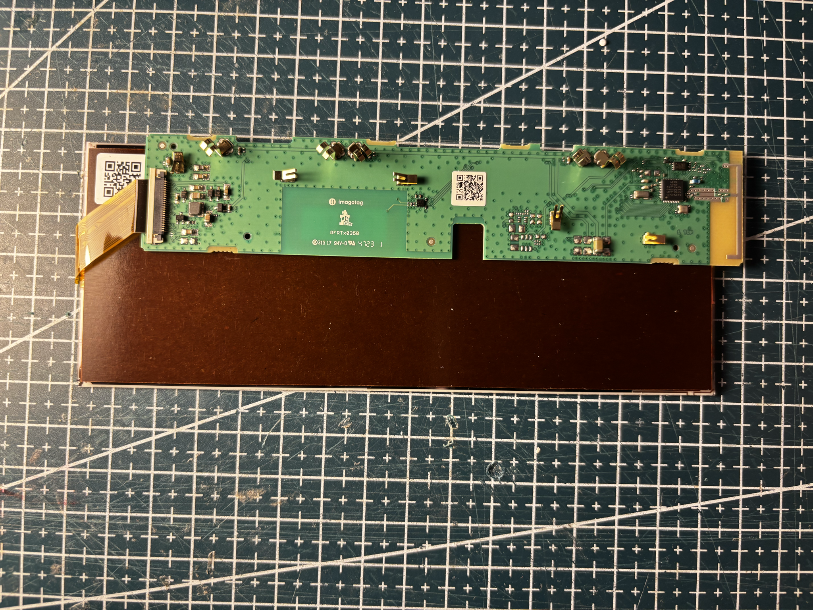
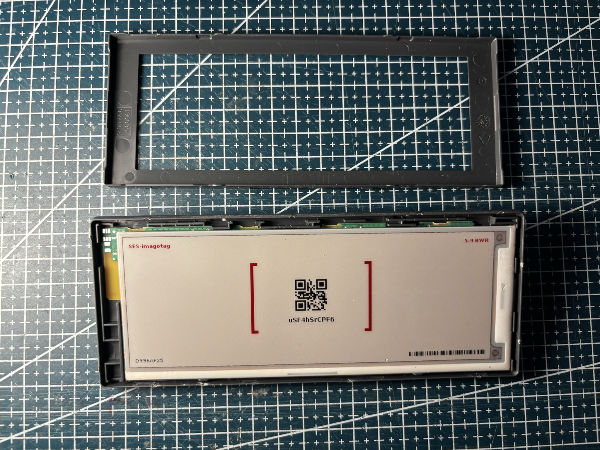
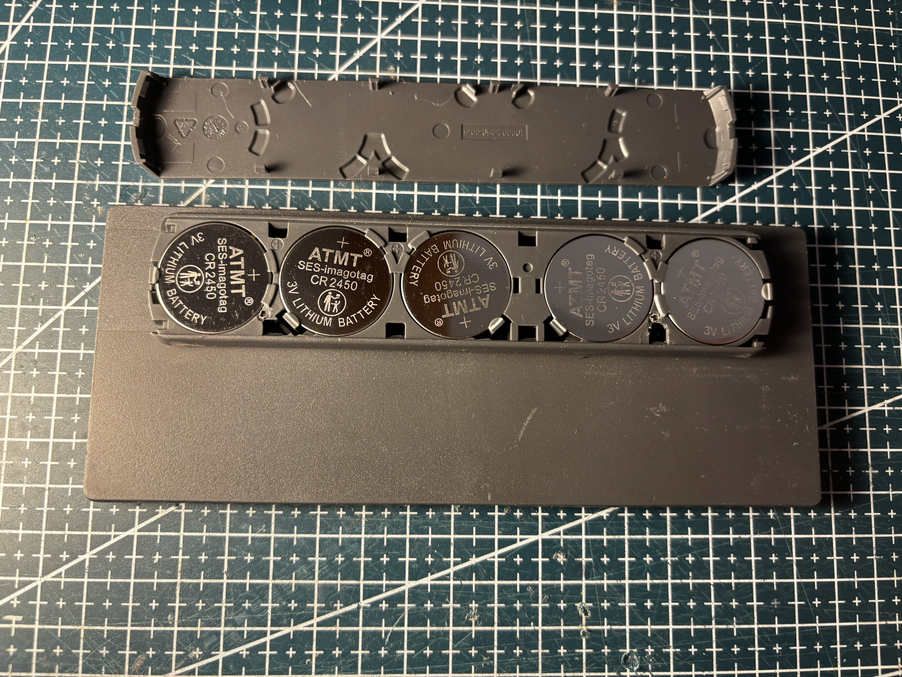
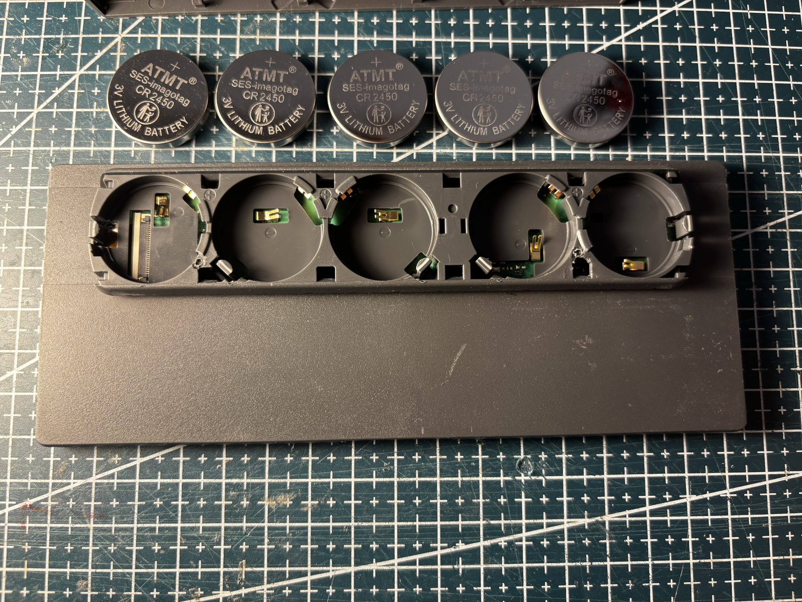
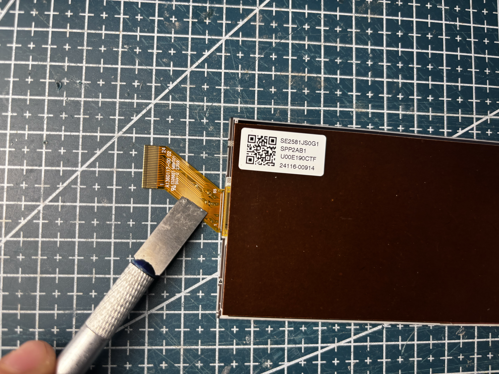
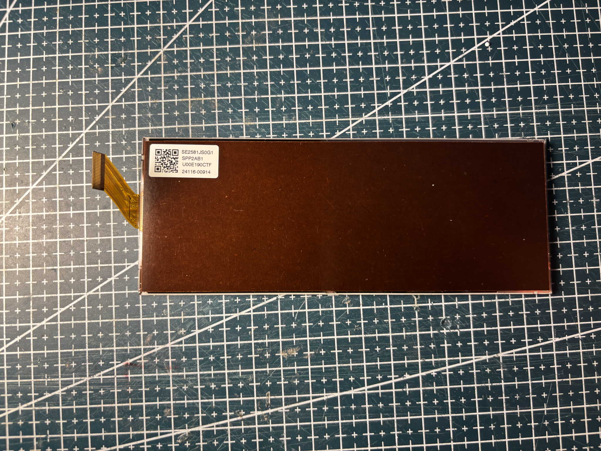
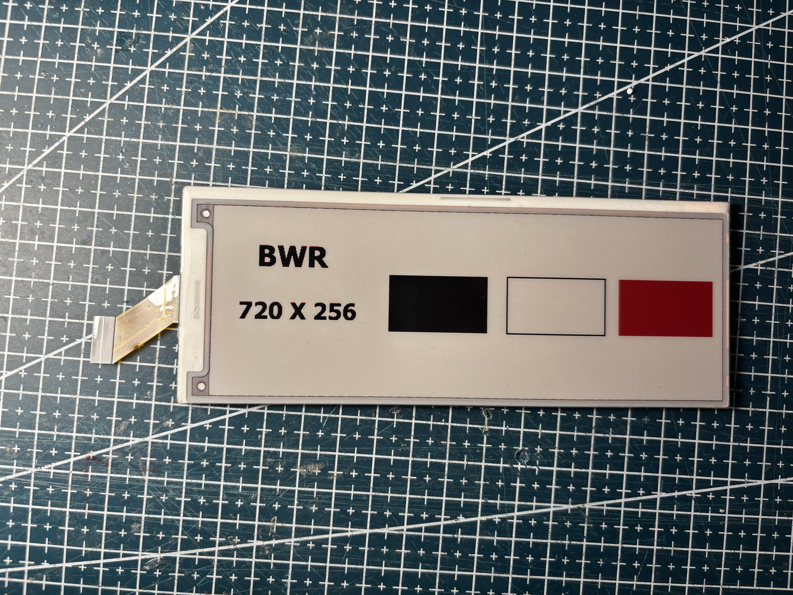

# VU-5.9-GU110-BWR

SES-imagotag / **Vusion** 5.9" class tag, gray housing.


## Identity

|         |                                                                             |
| ------- | --------------------------------------------------------------------------- |
| Brand   | SES-imagotag / Vusion                                                       |
| Name    | VUSION 5.9 BWR GU110                                                        |
| Model   | EDG3-0590-A                                                                 |
| Housing | gray                                                                        |
| Panel   | [SE2581JS0G1](../../../screens/581/BWR/SE2581JS0G1/README.md), BWR, 256×720 |

Details in [doc/references.md](doc/references.md).

## Panel

Sticker **SE2581JS0G1** / **SPP2AB1**. Native **256×720**, rotation 0. Driver `GxEPD2_581c_SE2581JS0G1` with **CS DC RST BUSY SCK MOSI** constructor (`ctor_sck_mosi`). Pervasive vendor library. Full refresh about 40 s.

## Reuse

```cpp
#include <GxEPD2_3C.h>

GxEPD2_3C<GxEPD2_581c_SE2581JS0G1, GxEPD2_581c_SE2581JS0G1::HEIGHT> display(
    GxEPD2_581c_SE2581JS0G1(/*CS*/ 5, /*DC*/ 17, /*RST*/ 16, /*BUSY*/ 4, /*SCK*/ 13, /*MOSI*/ 14));

void setup() {
  display.init(115200);
  display.setRotation(0);
  display.setFullWindow();
  display.firstPage();
  do {
    display.fillScreen(GxEPD_WHITE);
  } while (display.nextPage());
}
```

See [code/panel.ino](code/panel.ino).

## References from photos

| Photo                                                                              | Extracted references                                                                                                                                                                                                                                                                                               |
| ---------------------------------------------------------------------------------- | ------------------------------------------------------------------------------------------------------------------------------------------------------------------------------------------------------------------------------------------------------------------------------------------------------------------ |
|    | `EDG3-0590-A` (ESL tag model / SKU); `FCC ID: 2ACQM-EDG3-0590-A` (FCC / IC / CE / UKCA text); `IC: 12154A-EDG30590A` (FCC / IC / CE / UKCA text); `ses imagotag` (Brand or vendor name); `VUSION 5.9 BWR GU110` (ESL tag model / SKU)                                                                              |
|  | `2349` (Date code / lot); `24116-00914` (Panel module / glass ID); `94V-0` (FCC / IC / CE / UKCA text); `A1360117-00 02` (Flex / FPC part number); `E528827 MBHT01` (Flex / FPC part number); `SE2581JS0G1` (Panel module / glass ID); `SPP2AB1` (Panel module / glass ID); `U00E190CTF` (Panel module / glass ID) |
|      | `FG22 C121GG C02200 2330` (Date code / lot); `imagotag` (Brand or vendor name); `RFRRx035B` (PCB silkscreen / revision)                                                                                                                                                                                            |

## Photos

### Front


### Back


### Label


### Open



### Battery





### PCB


### Pinout



### Screen






## Acknowledgements

This panel runs with the driver classes from [shanislav/GxEPD2_PervasiveDisplays](https://github.com/shanislav/GxEPD2_PervasiveDisplays). Thanks to [shanislav](https://github.com/shanislav) for the driver classes, I lost a lot of time trying to get this panel working before finding this repository.
